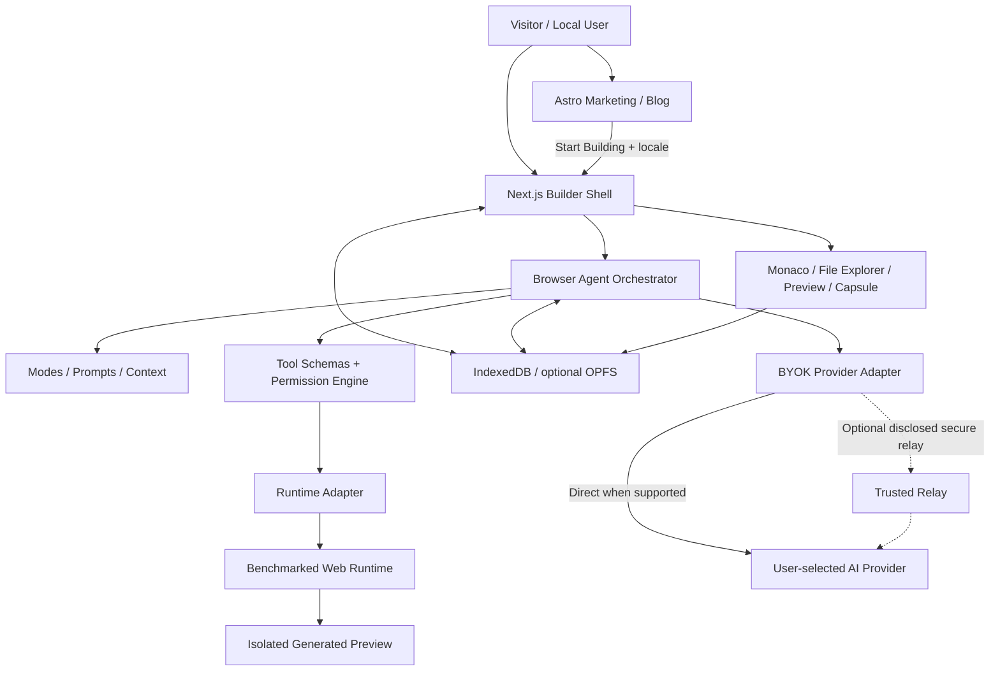

# LadeStack Build — Product Requirements Document (PRD)

> **Product:** LadeStack Build — a free, local-first, BYOK-powered agentic AI website and application builder  
> **Public domain (planned):** `https://build.ladestack.in`  
> **Public website:** Astro.js at `/`  
> **Builder:** Next.js App Router at `/app`  
> **Version:** 1.0 — Master Product Specification  
> **Document date:** 21 October 2026  
> **Document status:** **PLANNING / PROPOSED** — this is not a verified implementation or production-readiness claim  
> **Audience:** Product owners, engineering leads, UI/UX designers, AI coding agents, QA, localization editors, security reviewers, deployment maintainers

---

## Document control and interpretation

This PRD is the **product intent and acceptance contract** for LadeStack Build. It consolidates the agreed conversation-level requirements and previously produced project guidance (`README.md`, `SKILL.md`, `AGENT.md`, `do-&-not-do.md`, `INSTRUCTIONS.md`, `GUIDE.md`) and the supplied Cursor-inspired editorial design reference. The actual repository, released product, licenses, runtime test results, and deployments must be inspected independently before declaring any feature complete.

**Requirement status language:**

- **Required / P0:** Must be implemented and verified for the corresponding release gate.
- **High / P1:** Expected for the complete product, but may ship after the smallest functional alpha where explicitly indicated.
- **Enhancement / P2:** Roadmap requirement, not a promise for the first public release.
- **Research gate:** Must be verified with evidence before selecting a dependency, implementation, or launch claim.
- **Proposed:** Design/engineering recommendation awaiting implementation and validation.

**Important boundaries:** No mandatory login, user accounts, platform subscriptions, payments, pricing pages, or platform credits. Users bring their own AI provider credentials and may incur charges from that provider. The platform itself is intended to remain free to use. No ordinary user project's files may be uploaded to the product's development GitHub repository; the project's *own development repository* has a separate mandatory commit/push policy.

### Decisions locked by the product owner

1. The product is hosted under `build.ladestack.in`.
2. An **Astro multilingual public website** appears before the builder; the builder is **Next.js**.
3. **Features, Use Cases, How It Works, and Technology** are **homepage sections** (`#features`, `#use-cases`, `#how-it-works`, `#technology`), **not separate informational pages**.
4. **About, Contact, Blog, legal policies, and error experiences** are separate pages.
5. Eight languages: English, Russian, Japanese, Korean, Chinese, Turkish, French, Portuguese.
6. Every published article has **all eight genuine localized Markdown editions**; language switching translates the full UI/page and preserves equivalent context.
7. The supplied editorial design language is a strong reference, **excluding all pricing design**, with independent LadeStack branding and legally usable assets/fonts.
8. The builder uses **Kilo Code-derived/inspired agentic architecture** where technically and legally usable: modes, tools, prompts, permissions, workflows, checkpoints, and custom agents.
9. The builder is **local-first**: IndexedDB for project/session metadata and files; OPFS optional for larger blobs/caches; no central account/project database by default.
10. BYOK is the AI consumption model; no hidden platform-managed paid tiers.
11. Live editable Monaco code, VS Code-like file explorer, full-screen Code/Preview views, and a **minimal bottom-center AI activity capsule** are core UX commitments.
12. Browser runtime candidates (Lifo, WebContainers, Wasmer and lighter alternatives) are selected using **evidence-based benchmarks**, not aspirational claims.
13. Automatic dependency installation based on validated `package.json`, live preview and project ZIP download are key features.
14. Deployment must consider **Vercel** and **Cloudflare** compatibility, including correct Astro/Next route ownership, service workers, preview isolation and headers.
15. **After each completed repository code/file change, the authorized coding agent must validate, commit, push to GitHub, and verify the remote push**; never bypass safety checks or upload end-user content by default.

### Change-control rules

- Record meaningful product scope changes in this PRD and align related docs in the same reviewed change set.
- Do not silently broaden framework compatibility or the definition of “full stack.”
- Treat security, user data integrity, and secrets protection as hard blockers, not merely backlog items.
- New features must have an identified owner, priority, test plan, security review where relevant, and observable success/failure states.

---

## Contents

1. [Executive summary](#1-executive-summary)
2. [Product vision, positioning and principles](#2-product-vision-positioning-and-principles)
3. [Goals, non-goals and success metrics](#3-goals-non-goals-and-success-metrics)
4. [Personas, jobs-to-be-done and journeys](#4-personas-jobs-to-be-done-and-journeys)
5. [Scope, priorities and staged release definition](#5-scope-priorities-and-staged-release-definition)
6. [Information architecture, domain and routing](#6-information-architecture-domain-and-routing)
7. [Astro public website requirements](#7-astro-public-website-requirements)
8. [Multilingual i18n and content integrity](#8-multilingual-i18n-and-content-integrity)
9. [Markdown blog, editorial system and SEO](#9-markdown-blog-editorial-system-and-seo)
10. [Brand, design system and component governance](#10-brand-design-system-and-component-governance)
11. [Next.js builder application: screens and navigation](#11-nextjs-builder-application-screens-and-navigation)
12. [Welcome composer, templates and attachment handling](#12-welcome-composer-templates-and-attachment-handling)
13. [Project workspace, Monaco and live AI capsule](#13-project-workspace-monaco-and-live-ai-capsule)
14. [Agentic AI engine and Kilo Code integration](#14-agentic-ai-engine-and-kilo-code-integration)
15. [Agent modes, prompts, context and delegation](#15-agent-modes-prompts-context-and-delegation)
16. [Tool calling, approvals and execution safety](#16-tool-calling-approvals-and-execution-safety)
17. [BYOK providers, model capabilities and credentials](#17-byok-providers-model-capabilities-and-credentials)
18. [Browser runtimes, benchmarking and capability detection](#18-browser-runtimes-benchmarking-and-capability-detection)
19. [Automatic dependencies, dev servers and preview](#19-automatic-dependencies-dev-servers-and-preview)
20. [Local-first storage, projects and checkpoints](#20-local-first-storage-projects-and-checkpoints)
21. [ZIP export, import, backups and source portability](#21-zip-export-import-backups-and-source-portability)
22. [Settings and customizable preferences](#22-settings-and-customizable-preferences)
23. [Security, privacy, trust and compliance considerations](#23-security-privacy-trust-and-compliance-considerations)
24. [Errors, diagnostics, resilience and recovery](#24-errors-diagnostics-resilience-and-recovery)
25. [Accessibility, responsiveness and performance](#25-accessibility-responsiveness-and-performance)
26. [System architecture, packages and data flow](#26-system-architecture-packages-and-data-flow)
27. [Vercel, Cloudflare and environment strategy](#27-vercel-cloudflare-and-environment-strategy)
28. [Testing and quality-assurance matrix](#28-testing-and-quality-assurance-matrix)
29. [Analytics, measurement and ethical telemetry](#29-analytics-measurement-and-ethical-telemetry)
30. [Phased roadmap, dependencies and release gates](#30-phased-roadmap-dependencies-and-release-gates)
31. [Risks, mitigations and open decisions](#31-risks-mitigations-and-open-decisions)
32. [Requirements traceability and sign-off criteria](#32-requirements-traceability-and-sign-off-criteria)
33. [Mandatory GitHub change-delivery policy](#33-mandatory-github-change-delivery-policy)
34. [Appendix A: state machines and event contracts](#34-appendix-a-state-machines-and-event-contracts)
35. [Appendix B: acceptance scenarios](#35-appendix-b-acceptance-scenarios)
36. [Appendix C: terminology and canonical references](#36-appendix-c-terminology-and-canonical-references)

---

## 1. Executive summary

**LadeStack Build** is a browser-first AI product that lets people describe a website or supported web application, supply screenshots/docs/source references, and collaborate with an AI coding agent to produce a **readable, editable, runnable, exportable** project. Unlike a pure code-output chatbot, the product provides a project-aware tool execution loop, workspace files, code generation streaming, dependency management, diagnostics, a live preview, manual editing, version checkpoints, and a download-ready source ZIP.

The product consists of two independently developed experiences sharing one brand and public domain:

- **Astro marketing/editorial experience** (`/`): Human-written-quality, SEO-oriented, complete eight-language public site with homepage feature storytelling, About, Contact, Markdown Blog, legal policies and graceful errors. Public content does **not** imply functionality that has not passed release validation.
- **Next.js builder** (`/app`): Local-first React application with a minimal prompt-first entry screen; Kilo-inspired agent runtime; BYOK; Monaco IDE; browser-native compatible execution; Code/Preview switching; checkpoints; settings; reusable templates; ZIP portability.

**Success story:** A visitor lands on a localized page, understands free platform + BYOK, clicks Start Building, enters their API key without creating an account, prompts a supported React/Vite project, watches file changes appear in Monaco, sees dependency installation and live preview, asks the agent to improve a feature, compares/restores checkpoints, and downloads a complete usable ZIP. The product makes limitations visible before costs or irreversible changes occur.

**Critical architectural caveat:** No browser runtime should be advertised as executing every npm package, native binary, persistent backend, Docker container or database server. Runtime support and commercial license compliance are benchmark-gated. “Free for users” does not mean AI provider inference or platform operation is free.

---

## 2. Product vision, positioning and principles

### 2.1 Vision

Give creators and developers an approachable, transparent AI-native environment for building websites and web applications while preserving project ownership, inspectable code, execution safety, and freedom to leave with their source files.

### 2.2 Product promise

> Describe it. Build it with an agent. See and edit the code. Run a compatible preview. Keep the files.

### 2.3 Positioning

- **Primary category:** AI-assisted no-code/low-code web application builder.
- **Distinctive interaction:** Code-first live generation with a discreet activity capsule; full-preview toggle; user-controlled model and cost.
- **Differentiators:** BYOK/no account/no paid platform tier, local-first projects, version recovery, source ZIP portability, user-visible tools and approvals.
- **Design positioning:** Quiet editorial marketing design with a serious productivity IDE, not a maximalist neon dashboard.
- **Reference products:** Lovable/Bolt for interaction patterns; Kilo Code for agent concepts; VS Code for IDE ergonomics. Inspiration does not authorize copying proprietary visual assets or implementation.

### 2.4 Product principles

| Principle | Product implication |
| --- | --- |
| Minimal outside, powerful inside | First screen includes just prompt, attachments, modes, templates, and optional recent projects; advanced options are discoverable, not always visible. |
| User owns work | Source files remain editable and exportable; snapshots and user-originated assets are preserved. |
| Free platform access | No subscription checkout, platform credit plans, quotas advertised as sales, or mandatory authentication. |
| User-funded AI | BYOK credentials from supported providers; optional usage budget protects users from surprising provider costs. |
| Honest execution | Show true compatibility, install progress, preview state, tool failures and limitations. |
| Safe autonomy | Agent tool permissions are enforced by application code and runtime boundaries, not only system prompts. |
| Local-first privacy | Project contents are stored locally by default and transferred to AI providers only when relevant to explicit requests/consent. |
| Recovery by design | Interrupted streams, reloads and failed edits must not silently destroy earlier project state. |
| Accessibility as default | Complete keyboard interaction and screen-reader behavior where feasible, target WCAG 2.2 AA. |
| International consistency | All eight language editions convey materially equivalent functionality and legal meaning. |
| Controlled dependencies | Benchmarked runtime adapters, package policies, license verification and upgrades with rollback. |

---

## 3. Goals, non-goals and success metrics

### 3.1 Product goals

| ID | Goal | Verification |
| --- | --- | --- |
| G-01 | User enters the builder without account registration | No sign-in/signup gate on any core builder journey. |
| G-02 | User understands and configures BYOK | A compatible provider/model can be configured; sensitive key never appears in exported project or client logs. |
| G-03 | Agent completes an end-to-end supported React/Vite build | Project tree, verified manifest, dependencies, dev server, live preview, working source and download. |
| G-04 | User sees and controls agent actions | Tool calls, permissions, status, cancellation and diagnostics are inspectable. |
| G-05 | User can recover or take projects elsewhere | Autosave, checkpoints, restore, full ZIP export and ZIP import pass data-integrity tests. |
| G-06 | Public site supports international search and comprehension | All required pages/articles have complete native-feeling content for eight locales. |
| G-07 | Product works on selected deployment/browser combinations | Benchmarks, security gates and browser tests pass prior to launch. |
| G-08 | Marketing remains technically truthful | Claims map to tested capability flags and published limitations. |

### 3.2 Non-goals and exclusions

- No mandatory identity service, authentication flow, profile database, purchases, paid plans, platform credits, pricing page, pricing cards or upsell UI.
- No native mobile app in initial release.
- No guarantee of shared projects or cross-device sync without explicit import/export.
- No arbitrary always-on server hosting from the user’s browser after the browser tab closes.
- No guaranteed execution of arbitrary Python, Java, native Node addons, Docker, PostgreSQL or unsupported Next.js server features in browser runtimes.
- No automatic publication of user projects to GitHub, a cloud provider or an accessible URL without separate authorization.
- No assumption that every feature of a desktop Kilo Code build has a browser equivalent.
- No requirement to reproduce another brand's layout pixel-for-pixel, licensed typography or paid UI assets.
- No invisible automatic charge to an AI API without a user-configured provider, model and expenditure controls.

### 3.3 Proposed success indicators (targets, not observations)

| Metric | Initial acceptance / target | Notes |
| --- | --- | --- |
| Core task E2E | 100% pass on stable acceptance fixtures | Includes project creation, runtime, editing, restore, ZIP. |
| Critical runtime/security gates | 100% pass | Failures prevent publishing corresponding capability. |
| Successful clean React/Vite fixture | >=95% across repeated supported runs | Denominator and environment captured in benchmark report. |
| Generated project data integrity | 100% for tested reload/restore cases | No lost saved edits in corruption/partial-write fixtures. |
| Cached preview readiness | Proposed p95 <=8s on reference device | Benchmark target, not promise; measure cold separately. |
| Fresh React/Vite preview readiness | Proposed p95 <=30s on reference network | npm network limitations may defeat target; document actual result. |
| HMR update latency | Proposed p95 <=2s | Only supported compatible project templates. |
| i18n completeness | 100% translation keys and published page/article editions | Fail CI for missing required translation. |
| Accessibility | WCAG 2.2 AA as release target | Automated checks + human keyboard/screen reader testing. |
| Local-source export integrity | 100% for supported import/export fixtures | ZIP may exclude regenerable caches and secrets. |
| GitHub change delivery | Every completed, approved product-repo change pushed and verified | If blocked, state blockers; never claim success without remote proof. |

No telemetry about private prompts or source code may be introduced solely to calculate these metrics without user-aware privacy treatment.

---

## 4. Personas, jobs-to-be-done and journeys

### 4.1 Personas

| Persona | Primary goal | Constraints | Key journey |
| --- | --- | --- | --- |
| Solo founder | Build an MVP landing page/dashboard quickly | Cost-conscious, iterative requirements | Prompt -> Preview -> Refine -> Export |
| Vibe coder | Turn descriptions and screenshots into code | Wants visible changes but minimal manual commands | Attach mockup -> Agent builds -> Accept edits |
| Frontend developer | Accelerate React/Vite implementation | Needs file control, npm, diagnostics and Monaco | Import -> Edit -> Run -> Compare |
| Designer | Transform visual reference into usable UI | Needs image attachments and visual review | Screenshot -> UI generation -> Preview |
| Student/learner | Learn how AI built the project | Needs explanations and editable output | Ask mode -> Code mode -> Inspect files |
| Agency developer | Produce repeated structured website concepts | Needs templates and ZIP ownership | Choose template -> Customize -> Export |
| Privacy-conscious user | Avoid account sign-ups and cloud project storage | Data location, explicit API transmissions matter | Configure session key -> Work locally -> Backup |
| Multilingual visitor | Understand and use product in preferred language | Wants complete pages and same article continuity | Select locale -> Read docs/blog -> Build |

### 4.2 Primary journeys

**J-01: New visitor to first project**

1. Visit `build.ladestack.in` or a localized URL.
2. Read concise, accurate homepage content; inspect product demonstration and relevant use cases.
3. Click Start Building; locale persists into `/app`.
4. See a welcome title, prompt composer, attachment control, template discovery, mode/model selector and recent local projects.
5. Select a compatible AI provider, paste a user-owned API key and choose a tool-capable model.
6. Describe the desired project; agent starts planning and compatible runtime boot begins concurrently when practical.
7. Observe Monaco file generation and capsule activity; dependencies install on stable manifest.
8. Switch to Preview; inspect responsive result; ask AI for refinements; export ZIP.

**J-02: Extend an existing project**

1. Reopen a project from local recent projects, or import a supported ZIP.
2. Review project file tree and current runtime capabilities.
3. Use Code/Debug/Ask/Plan mode, optionally attach docs.
4. Approve tools under the selected permission policy.
5. Review diffs, run build, restore earlier checkpoint if needed.
6. Download the updated source ZIP or a full backup.

**J-03: Recover from failure**

1. Network drops mid-generation, API limit is reached, browser runtime crashes or a package cannot install.
2. Saved files and last committed checkpoint remain intact.
3. UI accurately reports paused/failed/canceled state and provides next actions.
4. User can retry, switch model/provider, revert unsafe changes or export current source.

**J-04: Multilingual editorial reading**

1. Open `/ja/blog/...` from a localized search result.
2. Read the entire article and interface in Japanese; metadata and CTAs are localized.
3. Change to French; navigate to the same canonical article’s French edition, not a generic index.
4. Click Start Building; builder UI opens in French while the user remains free to request project output in any language.

**J-05: Sensitive action approval**

1. Agent requests a tool to delete a file, run a command, access external network resources or restore an old version.
2. Policy engine evaluates arguments, target path, risk, mode and stored grants.
3. When confirmation required, user sees an understandable reason, affected scope and Allow Once / Deny controls.
4. No execution occurs before approval, and the outcome is recorded without secrets.

### 4.3 Cross-journey constraints

- Back/forward browser navigation must not silently discard edited project state.
- When leaving a generation session, warn about cancellation/recovery effects and keep confirmed changes.
- No mandatory sign-in, paywall or platform credit gate appears anywhere in these journeys.
- No generation begins with an unsupported provider/model without a comprehensible capability warning.

---

## 5. Scope, priorities and staged release definition

### 5.1 Delivery tiers

**P0 — Foundational product:** Monorepo, Astro pages and eight-locales, Markdown content, shared design system, Next.js welcome/project workspace, BYOK provider connectivity, Code/Plan/Ask/Debug essentials, validated tool execution, local project storage/autosave, checkpoints, Monaco live streaming, supported React/Vite runtime, dependency automation, preview, ZIP export, minimum settings, tool permission enforcement, security and browser deployment gates.

**P1 — Complete product:** Custom agent management, richer templates and attachments, code review mode, subagent/task delegation where safe, robust import, advanced diff and timeline UI, full blog editorial tooling, settings search, context compaction and more provider integrations.

**P2 — Advanced roadmap:** MCP integrations with browser-compatible or consented remote transports, visual element editing, browser automation, sophisticated multi-agent parallelism, local model connectors, optional deployment integrations, PWA shell and more languages/frameworks after verification.

### 5.2 Scope gates

- Public Astro site may ship **before** all Builder capabilities, but must label forthcoming features appropriately and avoid misleading Start Building behavior.
- A public AI builder alpha must have the end-to-end generation, preview, storage, checkpoint and export loop demonstrated in a supported environment.
- Unsupported runtime types must be routed to explicit compatibility notices rather than silent failing installation loops.
- Detailed final acceptance is defined by feature IDs later in this PRD and cannot be replaced by a visual mockup.

---

## 6. Information architecture, domain and routing

### 6.1 Domain and applications

```text
https://build.ladestack.in/
  -> Astro public, prerendered multilingual website

https://build.ladestack.in/app
  -> Next.js AI Builder, first-run welcome

https://build.ladestack.in/app/project/{localProjectId}
  -> Next.js local-first project workspace
```

**Deployment topology:** Single public hostname, two build/deploy outputs behind explicit path-based routing/rewrites/proxy. A single provider project cannot be assumed to run two independent framework servers automatically; route ownership, asset prefixes, locales, errors and middleware require tested configuration.

### 6.2 Public website pages — approved

| Route (English default) | Purpose | Notes |
| --- | --- | --- |
| `/` | Homepage with main sections | Must include `#features`, `#use-cases`, `#how-it-works`, `#technology`. |
| `/about` | Mission, makers, philosophy | Human and honest; no fabricated team claims. |
| `/contact` | Business email, social/community, support guidance | No contact form or login required. |
| `/blog` | Article listing/search/tags | Markdown content. |
| `/blog/{localized-slug}` | Article content | Separate localized versions linked by stable article ID. |
| `/privacy` | Privacy and data-handling disclosures | Must accurately disclose local storage, BYOK and optional relay. |
| `/terms` | Terms of use | Legal review before publication. |
| `/disclaimer` | AI/tool/runtime limitations | Do not disguise unsupported capabilities. |
| `/open-source` | Licenses, source acknowledgments | Include adopted third-party notices. |
| `/cookies` | Cookie/storage disclosure | Add when appropriate to real functionality and local law. |
| `/404` and supported error handling | Appropriate error UX | Real HTTP status behavior tested per host/runtime. |

Optional `/faq` and `/templates` informational pages require a separate product decision; core FAQ and template showcase are **homepage** elements, and template selection is primarily inside `/app`. **Do not create independent `/features`, `/use-cases`, `/how-it-works`, or `/technology` pages** unless the product owner changes scope.

### 6.3 Builder routes — proposed

| Route | Responsibility |
| --- | --- |
| `/app` | Welcome composer, template discovery, recent projects. |
| `/app/project/{id}` | Local project workspace with Code/Preview. |
| `/app/templates` | Expanded template gallery if needed. |
| `/app/settings` | Settings overview. |
| `/app/settings/ai` | BYOK providers, models, limits and connection checks. |
| `/app/settings/agents` | Agent modes, prompts and custom configurations. |
| `/app/settings/permissions` | Manual/Balanced/Auto policy and grants. |
| `/app/settings/runtime` | Browser runtime readiness and diagnostics. |
| `/app/settings/editor` | Monaco preferences. |
| `/app/settings/data` | Local data, backup, restore, export and quota. |

Locale prefix placement under `/app` must be consistent (proposed: `/app/ja/...` for non-default language); English default remains unprefixed. Project IDs are local references: a copied project URL does not by itself transfer project contents across devices.

### 6.4 Navigation acceptance requirements

- **WEB-ROUTE-01 / P0:** Astro owns non-`/app` routes; Next owns `/app` and its assets/API routes. Deep links work after full browser reload.
- **WEB-ROUTE-02 / P0:** Start Building navigates into the builder without requiring authentication and preserves locale.
- **WEB-ROUTE-03 / P0:** Homepage anchors work from both homepage and separate public pages; active/focus behavior is accessible.
- **WEB-ROUTE-04 / P0:** Unknown public/builder routes produce correctly scoped not-found UX with valid HTTP behavior where supported.
- **WEB-ROUTE-05 / P0:** Marketing and builder assets, service workers, CSP and runtime headers do not interfere with each other.

---

## 7. Astro public website requirements

### 7.1 Homepage narrative

The home page should be an editorial, warm and product-grounded experience: sparse top navigation; high-impact hero, short subheading, one strong orange Start Building CTA; a genuinely representative IDE/agent demonstration; compact feature and use-case compositions; clear free/BYOK/privacy explanation; final CTA and substantial multilingual footer.

**Recommended ordered sections:**

1. **Hero:** “From idea to working code” style messaging; no “build anything” or false universal-support guarantee. CTA -> `/app`.
2. **Product Showcase:** Code, agent activity, preview and file tree in a responsive mockup/video/demo. If nonfunctional, label it as illustration.
3. **Features** (`#features`): Agent modes/tool calls, live streaming, Monaco, browser runtime, BYOK, checkpoints, export.
4. **Use Cases** (`#use-cases`): SaaS landing pages, portfolios, agency sites, dashboards, business websites, e-commerce frontends, educational UI and other supported categories.
5. **How It Works** (`#how-it-works`): Describe -> Agent plans/acts -> Files appear -> Preview/refine -> Export.
6. **Technology** (`#technology`): Explain Kilo-derived agent ideas, Monaco, runtime compatibility, npm workflow, local-first storage and supported stacks. Do not present pending choices as final.
7. **BYOK & Your Code:** No platform payment, user-owned provider costs, local data, project export and honest limitations.
8. **Templates:** Representative category cards linking to builder context.
9. **FAQ:** BYOK fees, supported project classes, local persistence, API key handling, exports and browser support.
10. **Final CTA:** Focused Start Building action.
11. **Footer:** Navigation, About/Contact/Blog, legal/open-source, language control, brand attribution.

### 7.2 Functional requirements

| ID | Priority | Requirement and measurable acceptance |
| --- | --- | --- |
| WEB-01 | P0 | Astro home renders without JS for primary content and navigation. Core sections have correct anchor IDs. |
| WEB-02 | P0 | Navigation has Home, Features, Use Cases, How It Works, Technology, About, Blog, Contact, language selection and Start Building; responsive keyboard-friendly mobile navigation. |
| WEB-03 | P0 | Feature claims originate in a verified capability matrix; unavailable features labeled beta/planned or excluded. |
| WEB-04 | P0 | Start Building CTA sends user to the correct localized builder route; no sign-up or pricing detour. |
| WEB-05 | P0 | About page communicates purpose, free/local-first approach, ownership and authentic maker information only when provided. |
| WEB-06 | P0 | Contact page includes intended official email/social links; no form collecting personal data by default. |
| WEB-07 | P0 | Privacy, Terms, Disclaimer and open-source credits are findable in footer, keyboard accessible and localized. |
| WEB-08 | P0 | Astro has a custom 404; genuine 500/503 paths are treated according to the actual static/SSR/hosting behavior. 501 only for real not-implemented server behavior. |
| WEB-09 | P1 | Template and feature showcases can use tabs, cards, demonstrations and diagrams without unnecessary hydration. |
| WEB-10 | P1 | Product screenshots/demo visuals are accurately representative, responsive and accessible with text alternatives. |
| WEB-11 | P1 | FAQ supports accessible expand/collapse and provides accurate technical distinctions between provider charges and platform fees. |
| WEB-12 | P1 | RSS/changelog/support-resource discoverability is added when editorial volume justifies it. |

### 7.3 Content and design guidance

- Use plain, human, specific English and expertly edited localized variants. Avoid repetitive AI-generated clichés, unsupported superlatives, false urgency and promises of zero provider costs.
- Each feature should articulate a problem, a capability and a user benefit with example screenshots/snippets when appropriate.
- Marketing may use carefully selected components from the chosen libraries, but should default to static Astro HTML/CSS over heavy client hydration.
- Mobile should prioritize a simplified IDE demonstration and readable navigation, not a miniature desktop IDE squeezed into a narrow frame.

---

## 8. Multilingual i18n and content integrity

### 8.1 Required locale registry

| Language | Primary locale | Route prefix | Editorial note |
| --- | --- | --- | --- |
| English | `en` | none | Default language and source-of-truth editorial intent. |
| Russian | `ru` | `/ru` | Native grammar and terminology. |
| Japanese | `ja` | `/ja` | Localized concise UI strings, suitable typography. |
| Korean | `ko` | `/ko` | Natural polite tone, avoid literal English calques. |
| Chinese | `zh` | `/zh` | Default Simplified Chinese unless regional decision changes. |
| Turkish | `tr` | `/tr` | Correct inflection, casing and UI wording. |
| French | `fr` | `/fr` | Natural UI/formality choices; expanded labels may need more width. |
| Portuguese | `pt` | `/pt` | Choose and document a consistent regional convention. |

These **eight**, not nine, are the latest expressly required language set. Future locales are separate scope.

### 8.2 Translation model

- Use shared locale identifiers and agreed product terminology across Astro and Next.js, while keeping framework-native routing implementations independent.
- UI dictionaries hold controls, tooltips, error messages, onboarding, settings, accessibility labels, legal navigation and agent states.
- Longform Astro pages and blogs use **real localized content** (not runtime machine-translation widgets).
- User-created project content **does not automatically change language** when the product UI locale changes.
- Canonical article IDs and explicit locale-slug mappings keep users on equivalent content when switching language.
- Default English URLs may be unprefixed; all other locales use stable prefixes; avoid duplicate route systems that return indistinguishable pages.
- Persist last user locale in non-sensitive local preference storage when appropriate; pass locale via URL across Astro/Next boundaries to avoid relying on cross-app storage sharing.

### 8.3 Requirements

| ID | Priority | Requirement and measurable acceptance |
| --- | --- | --- |
| I18N-01 | P0 | All eight locales are routable for all required Astro pages and builder primary routes. |
| I18N-02 | P0 | Switching locale translates complete page/navigation/metadata, not only a language badge or headline. |
| I18N-03 | P0 | Switching locale while reading an article maps to that article's exact translated edition by stable ID. |
| I18N-04 | P0 | Every published blog post has all eight content files and required frontmatter; missing variants fail publication validation. |
| I18N-05 | P0 | Build/CI fails on missing required translation keys or unsupported locale codes. |
| I18N-06 | P0 | Dates, numbers, relative times, labels and directionality are localized appropriately using locale-aware formatting. |
| I18N-07 | P0 | Astro-to-Next navigation preserves locale, including Start Building links in articles and footer. |
| I18N-08 | P0 | Localized metadata, canonical URLs, sitemap entries and hreflang alternates are correct and reciprocal. |
| I18N-09 | P1 | Translation QA includes native-feeling tone, appropriate line breaks, copy length and accessibility announcements. |
| I18N-10 | P1 | Builder agent/tool status, errors, confirmation dialogs, settings and checkpoints use localized UI copy. |
| I18N-11 | P1 | Content editor can preview translation completeness and compare editions before publication. |

### 8.4 Language switching acceptance examples

- Open `/fr/about`, switch to `ja`: visit `/ja/about` with entire page and metadata localized.
- Open a Russian Markdown article and switch to Korean: visit that article's Korean slug and preserve section anchor if an equivalent anchor exists.
- Start Building from `/pt/#features`: launch localized `/app/pt` (or the final registered equivalent) with Portuguese controls; AI request language remains determined by user prompt/project settings.
- A missing translation is surfaced as a publishing error and is not silently replaced with English while claiming full localization.

---

## 9. Markdown blog, editorial system and SEO

### 9.1 Content system

- Use **Astro Content Collections** to validate Markdown article frontmatter, generate static pages and manage typed article metadata.
- Each article has a stable **translation group identifier** independent of localized slug.
- Required frontmatter: `id`, `locale`, `slug`, `title`, `description`, `publishedAt`, `updatedAt` (when updated), `tags`, `category`, `status`, `author` (when accurate), `cover` (when supplied), `canonical`/translation links as needed.
- Each article is locally reviewable, authored/translated in complete Markdown, and published atomically across all eight locales.
- Technical samples, diagrams and links must be validated for each locale; code remains in code blocks with accessible descriptions.
- Published edits update all affected translations intentionally, with stale localization detection and editorial review.

### 9.2 Editorial features

Article listing, category/tag filtering, internal search suitable for static pages, featured and related content, reading time, navigation, headings/table of contents for long tutorials, syntax-highlighted code blocks, author/date metadata, prev/next or related links, and RSS where practical.

**No database/CMS is required to store Markdown content.** A future CMS would be a separate choice with operational/privacy consequences.

### 9.3 SEO requirements

| ID | Priority | Requirement and measurable acceptance |
| --- | --- | --- |
| SEO-01 | P0 | Homepage, secondary pages and articles have unique localized title/description. |
| SEO-02 | P0 | Canonical and reciprocal hreflang links resolve to actual available localized URLs, with optional `x-default` where appropriate. |
| SEO-03 | P0 | XML sitemap and robots.txt route to public crawlable pages; no private/local project content enters sitemap. |
| SEO-04 | P0 | Static Astro HTML contains essential content without client-side rendering dependency. |
| SEO-05 | P0 | Meaningful heading hierarchy, alt text, accessible links and metadata are validated. |
| SEO-06 | P0 | 404/errors are not indexed as successful pages; HTTP status handling is correct for deployment platform. |
| SEO-07 | P1 | Relevant structured data (Organization/WebSite/Article/Breadcrumb) reflects actual entities and page content. |
| SEO-08 | P1 | Blog has article translation coverage report, internal-link checker and broken-link validation. |
| SEO-09 | P1 | Optimized image sizes, responsive image sources and lean page assets meet specified performance budgets. |
| SEO-10 | P1 | Editorial checklist flags unsupported product claims, duplicate autogenerated text and missing first-hand evidence. |

### 9.4 User trust / legal publishing

Privacy and legal docs describe *actual* local storage, provider-bound request data, any optional relay, cookie usage, export behavior, third-party package execution and user responsibilities. Legal review is required before publication. “Private by default” must be qualified when user's prompts/files are sent to an external AI provider or relay.

---
## 10. Brand, design system and component governance

### 10.1 Visual direction

The supplied design specification is an **editorial, warm-cream, hairline-borders, restrained-orange** reference inspired by Cursor's marketing presentation. Reinterpret it as an independent **LadeStack Build** design. Do not use Cursor name, mark, trademarked visuals, or licensed font without a license. **All pricing components in the source reference are expressly excluded.** No pricing cards, plans, “Enterprise Sales,” checkout or trial upsell pages.

**Marketing surface:** Warm cream background, warm ink text, high editorial whitespace, concise code-related illustrations and sparse orange CTAs.  
**Builder surface:** Same brand tokens for shell/settings, with a deliberate dark, high-legibility Monaco coding workspace and minimal bottom-center capsule. Light and dark editor preferences can be offered. Do not blindly apply warm cream to every code pane when a dark coding environment better meets the usability requirement.

### 10.2 Source-derived tokens (to be remapped into LadeStack names)

| Token | Target | Usage |
| --- | --- | --- |
| Canvas | `#F7F7F4` | Primary public website background. |
| Canvas soft | `#FAFAF7` | Product demos and IDE mockups. |
| Surface card | `#FFFFFF` | Light cards. |
| Warm ink | `#26251E` | Headings/high-contrast text. |
| Body | `#5A5852` | Running prose. |
| Muted | `#807D72` | Secondary descriptions. |
| Hairline | `#E6E5E0` | Minimal borders and dividers. |
| Brand accent (reference) | `#F54E00` | Sparingly used primary CTA; re-evaluate accessible text contrast. |
| Accent active | `#D04200` | Active/pressed reference variant, subject to contrast tests. |
| Thinking pill | `#DFA88F` | Agent timeline only. |
| Search/grep pill | `#9FC9A2` | Agent timeline only. |
| Read pill | `#9FBBE0` | Agent timeline only. |
| Edit pill | `#C0A8DD` | Agent timeline only. |
| Done pill | `#C08532` | Agent timeline only; not a generic success color. |
| Success | `#1F8A65` | Semantic success. |
| Error | `#CF2D56` | Semantic error. |

**Typography:** Inter/Geist or other properly licensed, multilingual-capable fonts; normal-weight large editorial display (reference around 72px desktop/32px mobile), subtle negative tracking, JetBrains Mono for code (or suitable localized fallback). The reference CursorGothic is licensed and **not** automatically available. Track font metrics and line breaking in Russian, Japanese, Korean, Chinese, Turkish, French and Portuguese.

**Layout:** 4px scale; max-width approx. 1200px; 12-column editorial grid; ~80px desktop vertical section rhythm; 8px compact button radius and 12px card radius; 1px hairline depth; avoid decorative shadow stacks and gratuitous glassmorphism. Adapt to 320px+ mobile widths through coherent responsive specifications, not simple downscaling.

### 10.3 Approved design resource roles

| Resource | Role | Guardrail |
| --- | --- | --- |
| `https://ui.shadcn.com/` | Primary component architecture and consistent design tokens | Select one coherent primitive base; audit copied dependencies. |
| `https://react-aria.adobe.com/` | Accessible interaction patterns, focus, keyboard and collection behavior | Do not stack incompatible focus/dialog systems without reason. |
| `https://www.kibo-ui.com/` | Specialized functional UI (dropzone, code snippets, etc.) | Audit each component's dependencies and license; Monaco remains main editor. |
| `https://ui.aceternity.com/components` | Selective motion and visual enhancement | No distracting IDE effects; confirm commercial/redistribution terms. |
| `https://vibrant.design/` | Visual research and composition inspiration | Inspiration is not a component license or permission to copy a design. |
| Monaco Editor | Interactive code editing and diff | Not interchangeable with read-only code-block components. |
| Lucide | Shared iconography | Keep accessible labels and consistent sizes. |

### 10.4 Design requirements

| ID | Priority | Acceptance |
| --- | --- | --- |
| DS-01 | P0 | One branded token system and approved typography map across Astro/Next. |
| DS-02 | P0 | Public marketing matches warm-cream/editorial direction without proprietary brand imitation. |
| DS-03 | P0 | Builder has clear Code and Preview surfaces with professional readable Monaco theme. |
| DS-04 | P0 | Design includes no pricing components, sign-up buttons or platform upsell affordances. |
| DS-05 | P0 | Contrast, focus indication, touch target sizes and interactive semantics are audited. |
| DS-06 | P0 | Component dependencies and redistribution rights are reviewed, especially for content potentially exported in user ZIPs. |
| DS-07 | P1 | Motion is subtle, contextual, interruptible and honors reduced-motion. |
| DS-08 | P1 | Every visual state—loading, success, error, offline, blocked, syncing—has a design specification beyond color alone. |
| DS-09 | P1 | Layouts remain readable in all eight locales with long copy and localized fonts. |

---

## 11. Next.js builder application: screens and navigation

### 11.1 Experience composition

The builder is a **client-centric Next.js application**, not a replacement for the user's project runtime. Next.js hosts the trusted UI and optional secure provider relay; a distinct **browser-runtime adapter** executes compatible generated projects. Browser storage is authoritative for project content. Next.js server components must not assume direct access to user's IndexedDB.

**Screen A — Welcome:** Centered greeting, expanding prompt composer, attachments, agent mode/model selector, template browsing, recent local projects, connection state and optional compact settings. No account gate. User should understand platform is free but their AI provider may charge.

**Screen B — Project Workspace:** Full-screen Code or Preview primary views (not a cramped mandatory split). Top header with project name, current mode/provider, Code/Preview toggle and ZIP export. In Code view, a VS Code-like file tree, Monaco tabs, path breadcrumbs, search, editing, diagnostics and optional terminal drawer. In Preview view, the application viewport takes prominence with responsive device selectors, refresh/reconnect and error overlay.

**Bottom-center activity capsule:** During active AI work, a small animated progress capsule summarizes file edits and runtime activity. When idle, it becomes or reveals a compact prompt composer. Expanded mode exposes agent actions, approvals, progress and history. Never hide critical warnings exclusively inside transient animations.

### 11.2 Screen requirements

| ID | Priority | Acceptance |
| --- | --- | --- |
| APP-01 | P0 | `/app` loads a usable welcome screen before initializing heavyweight runtime/code components. |
| APP-02 | P0 | Anonymous user can create/open/edit a local project; no remote account required. |
| APP-03 | P0 | Builder has responsive top-level navigation, settings and language control. |
| APP-04 | P0 | Project workspace offers exclusive Code and Preview primary views; changes remain intact when switching. |
| APP-05 | P0 | Project header shows real project identity, status and functional ZIP export. |
| APP-06 | P0 | Monaco supports editable tabs, file navigation, syntax modes, search, selection and unsaved-change indicators. |
| APP-07 | P0 | File explorer shows nested directories and supports correct path-based navigation; destructive actions are confirmable and undoable where possible. |
| APP-08 | P0 | Agent capsule is compact and bottom-centered during generation, with accessible expanded detail and truthful status. |
| APP-09 | P0 | Code view remains focused on live code; agent progress never monopolizes the center panel. |
| APP-10 | P0 | Preview view displays only a verified browser runtime preview or an explicit loading/error state; no invented preview URL. |
| APP-11 | P0 | Pending user edits survive navigation between screens, project tabs and reloads after successful autosave. |
| APP-12 | P1 | Keyboard command palette, keyboard shortcuts and searchable files support power users. |
| APP-13 | P1 | Responsive design separates panes/flows on mobile rather than shrinking a desktop IDE illegibly. |
| APP-14 | P1 | Optional terminal/diagnostics drawer, file diff panel and checkpoint explorer are reachable without changing the two primary views. |

### 11.3 UI states and important distinctions

- **View mode** is Code or Preview; **agent mode** is Code, Plan, Ask, Debug, Review, Orchestrate or Custom. These must be visually distinct controls.
- **Project status** is saved/unsaved, generating, running, blocked, failed or recoverable. Do not confuse “file created” with “build passed.”
- A generation action may be canceled, paused/blocked or completed. Cancel must not retroactively claim unsaved tokens as committed files.
- If the user switches to another file while AI writes, retain the user-selected tab; offer a “follow AI edits” toggle rather than hijacking focus.

---

## 12. Welcome composer, templates and attachment handling

### 12.1 Prompt composer

- Multiline composer, auto-growing from a compact initial state, accessible paste, keyboard submit behavior, clear validation and visible cancel state.
- Attach reference screenshots/images, source files, docs, Markdown, CSV/spreadsheets, text and appropriate archives; show file chip/previews and remove option.
- Support agent-mode selection and model/provider selection; require valid BYOK configuration before paid AI calls; allow exploring templates even before BYOK.
- Prompt enhancement is an optional deliberate action, **not** an invisible charge to the user's API key.
- Preserve draft prompt/attachments across reasonable navigation without exposing secrets.

### 12.2 Attachment categories

| Category | Representative formats | Expected handling |
| --- | --- | --- |
| Images | PNG, JPEG/JPG, WebP, GIF, SVG, AVIF where decoder supports | Preview and extract safe image bytes for supported vision models. |
| Code/text | HTML, CSS, JS, JSX, TS, TSX, Python, JSON, YAML, XML, TXT, MD, MDX | Parse as text/reference or import into project only through user-approved workflow. |
| Documents | PDF, DOCX (DOC only with supported parser) | Extract text/structure; do not promise perfect scanned OCR or layout fidelity. |
| Spreadsheets | CSV, XLSX, ODS where parsers supported | Extract selected sheets/tables, formulas as data where relevant. |
| Archives | ZIP | Secure inspect/import; guard zip-slip, excessive decompression and hidden executable content. |
| Configuration | `package.json`, lockfiles, `.env.example` | Project-aware parsing; never ingest actual secrets into prompts by default. |

“Accept most major formats” refers to configurable support levels. A format can be uploadable but not semantically parsed; the UI must distinguish `accepted`, `parsed`, `partially processed`, `unsupported` and `rejected`.

### 12.3 Templates

Initial categories: Business/Corporate, SaaS, Portfolio, Agency, Landing Pages, Dashboards/Analytics, E-commerce, Blog/Content, Education, Hospitality, Booking, Real Estate, AI Apps and Developer Tools. Expand only with tested templates.

Two legitimate actions: **Use prebuilt starter** (low/no AI cost) or **Generate a fresh project inspired by template** (AI-consuming). Template cards should display project type and requirements truthfully, support filtering/keyboard navigation and never promise runtimes unsupported by benchmarks.

### 12.4 Requirements

| ID | Priority | Acceptance |
| --- | --- | --- |
| INTAKE-01 | P0 | Prompt supports multiline text, submit, disabled/loading/cancel state and recovery of draft. |
| INTAKE-02 | P0 | File picker and drag/drop provide per-file type, size and validation feedback. |
| INTAKE-03 | P0 | Image reference + code file + Markdown document can be combined in one request on a capable provider. |
| INTAKE-04 | P0 | Extracted attachment context is bounded by provider capability/token budget and shown as relevant references. |
| INTAKE-05 | P0 | Executable or credential-containing attachments are not automatically run/transmitted as raw secrets. |
| INTAKE-06 | P0 | Templates can load real runnable starter files without invoking AI if user chooses that flow. |
| INTAKE-07 | P1 | Safe ZIP import and multi-file document extraction with structured status; unsupported formats explain limitation. |
| INTAKE-08 | P1 | Prompt enhancement displays revised proposal for confirmation and makes API cost behavior obvious. |

---

## 13. Project workspace, Monaco and live AI capsule

### 13.1 Code generation UX

During a generation task, the agent emits **structured file operation events** along with model token streaming. Monaco displays the currently generated document incrementally, but committed project files are updated only through validated writes or coherent batch patches to prevent half-token compile churn. Files can be freely viewed/edited; editor cursor/scroll position must be protected from automatic focus-stealing.

**Generation capsule:** Show one active file prominently. Queued → generating spinner → writing/saving → completion green tick → transition upward to next file; retain full activity in expandable history. Installation, tests and preview readiness have their own independent statuses; do not imply completion of the whole app from a single file tick.

**End state:** On completion, capsule shrinks into a prompt input with accessible recent-event history, next-action suggestions (View Preview, Inspect Issues, Download ZIP) and clear error details if validation failed.

### 13.2 File edit transaction model

1. Agent declares intended file operation and target path.
2. Permission engine checks mode, scope, destructive risk and user policy.
3. Project manager records base revision and optionally a pre-change checkpoint.
4. Streaming view may show a draft overlay to Monaco; stable validated changes are applied to a revisioned file store.
5. Runtime adapter receives coherent file writes; HMR/build events update diagnostics.
6. If manual edit races with an AI patch, compare base revision and resolve conflict explicitly; no silent last-write-wins overwrite.
7. Capsule/status view reports actual write success, error, or conflict, not invented progress.

### 13.3 Workspace requirements

| ID | Priority | Acceptance |
| --- | --- | --- |
| WORK-01 | P0 | Streaming output is visible live in Monaco with correct target file/path and reasonable throttling. |
| WORK-02 | P0 | Agent can create/move/edit files via typed tool operations with success/failure result. |
| WORK-03 | P0 | Explorer and tabs track file changes; manual tab selection remains stable during generation. |
| WORK-04 | P0 | Capsule transitions spinner → success tick for completed file and moves to next, retaining history. |
| WORK-05 | P0 | Capsule's save-complete state is distinct from runtime compile/test success. |
| WORK-06 | P0 | User can cancel current generation and retain last committed/autosaved state. |
| WORK-07 | P0 | AI/manual concurrent edits cause a deterministic conflict/merge flow; no silent overwrite. |
| WORK-08 | P0 | Code and Preview views do not unmount/destroy persisted project source when switching. |
| WORK-09 | P1 | Diff view, undo/redo, errors and diagnostics are integrated without making the UI cluttered. |
| WORK-10 | P1 | Generation activity is fully keyboard accessible and screen-reader announcements are rate-limited. |

---

## 14. Agentic AI engine and Kilo Code integration

### 14.1 Approach

Use the **Kilo Code GitHub repository** (`https://github.com/Kilo-Org/kilocode`) as the agentic reference/source where current version license and dependency terms permit. Reuse/adapt suitable concepts or code for session loops, model providers, tools, prompt composition, permissions, modes, workflows and checkpoints. **Never assume VS Code extension/desktop CLI/Bun/Node subprocess/SQLite/native OS assumptions will work unmodified in Next.js client components.**

Before adaptation, create a **source-compatibility inventory**: upstream revision, exact file/package, SPDX/license, transitive dependencies, browser import constraints, test coverage, security surface, copy-vs-port decision and maintenance ownership. Keep original copyright/attribution notices. Do not imply upstream endorsement or reuse Kilo logos without permission.

### 14.2 Agent loop

```text
User request + chosen mode + verified model capability
  -> Context and system prompt assembly
  -> Model streaming / structured tool call
  -> Tool schema validation + authorization
  -> Project-scoped execution in browser adapter
  -> Tool result + diagnostics returned to model
  -> Continue / ask user / block / retry / finish
  -> Verify results + checkpoint + summarize
```

Agent execution is **event-driven and bounded**. There must be controls for cancellation, max turns, tool budgets, timeout, token-cost estimates where provider exposes usage, retries and explicit user approvals. Tool results are untrusted and may include malicious text; they must not rewrite high-priority instructions or grant capabilities.

### 14.3 Requirements

| ID | Priority | Acceptance |
| --- | --- | --- |
| AGENT-01 | P0 | Agent loop executes multiple tool calls with observed results rather than returning only a block of unstructured generated code. |
| AGENT-02 | P0 | All tool calls use strict schema validation, execution IDs and status/error reporting. |
| AGENT-03 | P0 | User can cancel or stop the current agent loop; no stale tool result may mutate a newer project revision. |
| AGENT-04 | P0 | Kilo-adopted modules pass browser compatibility, legal and security audit before inclusion. |
| AGENT-05 | P0 | Mode-specific tool permissions are actually enforced; no prompt-only protection. |
| AGENT-06 | P0 | Session conversation, summaries and tool events are persisted locally without credentials. |
| AGENT-07 | P1 | Specialized tasks can be delegated to qualified subagents with explicit scope and parent-result reconciliation. |
| AGENT-08 | P1 | Context compaction and relevant-file retrieval reduce repetitive token expenditure without losing critical instructions. |
| AGENT-09 | P1 | Custom agent configurations persist locally and can be exported/imported without secrets. |
| AGENT-10 | P2 | Opt-in skills/MCP/custom remote tools are integrated behind capability, transport and authorization gates. |

### 14.4 Completion standard

A task is complete when requested file changes are committed to the **user's local project model**, tool operations have finished or are clearly blocked, post-change validation results are available, a recoverable checkpoint exists, and the user sees an accurate summary. “AI said done” alone is not sufficient.

---

## 15. Agent modes, prompts, context and delegation

### 15.1 Required modes

| Mode | Purpose | Default risk posture |
| --- | --- | --- |
| **Code** | Implement and refine project files | Project-scoped writes and validated installs; sensitive ops require review. |
| **Plan / Architect** | Analyze requirements and propose implementation plan | Read-only to project source; no default execution of edits. |
| **Ask** | Answer questions about current project | Read/search only, no project mutation. |
| **Debug** | Read diagnostics, diagnose root cause, perform approved targeted fixes | Read/runtime diagnostics; edits only after permitted workflow. |
| **Review** | Inspect changes for bugs, accessibility, security and maintainability | Default read-only with optional fix proposal. |
| **Orchestrate** | Plan multi-step work and delegate to specialized subagents | Delegation constrained by parent and child permissions. |
| **Custom** | User-defined prompt/model/tool configuration | Cannot elevate privileges beyond application policy. |

Some modes may be locally defined implementations rather than exact current upstream Kilo mode names. Version-specific upstream parity must be documented, not assumed.

### 15.2 Prompt layering

1. Trusted platform safety/system policy and non-overridable scope.
2. Agent core instructions and tool protocol.
3. Selected mode-specific instructions.
4. Runtime capability and project/framework constraints.
5. Project rules and conventions (`AGENTS.md`/documented project instructions as *untrusted user content*).
6. Relevant local project tree/files, errors and previous task summary.
7. Current user prompt, attachments and approved custom agent instructions.

**Priority:** Untrusted attachments, dependency scripts, tool output, external web text and imported project rules never supersede platform tool permissions, scope or secrets policy. Do not concatenate unchecked retrieved text into a high-trust system instruction role.

### 15.3 Context manager

Maintain task-level relevant files, impact/import relationships, conversation summaries, diagnostic messages and tool-result truncation. Track model context-window limitations, max output size, vision/tool availability and provider usage; indicate when context was summarized and permit the user to inspect or override selected files.

### 15.4 Requirements

| ID | Priority | Acceptance |
| --- | --- | --- |
| MODE-01 | P0 | Code, Plan, Ask and Debug have visibly distinct tool permission contracts. |
| MODE-02 | P0 | Switching modes preserves session/project state and never silently enables broader permissions. |
| MODE-03 | P0 | Prompt composer references active mode, provider/model and project context. |
| MODE-04 | P0 | Project instructions cannot override protected app/system policies. |
| MODE-05 | P1 | Review, Orchestrate and Custom modes work with test fixtures and mode-specific prompt definitions. |
| MODE-06 | P1 | Context compaction preserves critical context and source citations/paths while avoiding huge full-repository re-sends. |
| MODE-07 | P1 | Subagent execution is budgeted, logged and parent-approved where needed. |
| MODE-08 | P2 | User can import/export safe custom agent definitions and skills. |

---

## 16. Tool calling, approvals and execution safety

### 16.1 Proposed tool contract

Each tool has `name`, `description`, strict parameter schema, required capabilities, default risk, target project boundary, authorization decision, cancellation behavior, output schema and audit-friendly event metadata.

| Tool capability | Example behavior | Baseline policy |
| --- | --- | --- |
| Read/list/search | Read project files and search code | Allow within selected project. |
| Create/edit/patch | Write validated source files | Allow in Code mode with checkpoint and path constraints. |
| Delete/rename | Remove/move files | Ask for destructive or broad operations. |
| Install dependencies | Install validated package graph | Auto when safe and user enabled; explicit block on dangerous scripts/policy. |
| Execute command | Run predefined dev/build/test scripts | Constrained allowlist or ask; no host-OS shell rights. |
| Diagnostics/preview | Read compiler logs and preview status | Allow read-only. |
| Create checkpoint | Preserve pre/post task revision | Automatic. |
| Restore checkpoint | Replace working state from snapshot | Ask/confirm; preserve current state. |
| Network/search | Fetch docs or package metadata | Permission/capability constrained; untrusted results. |
| Delegate task | Request subagent work | Parent scope and budget inherited. |
| Export ZIP | Prepare source bundle for download | User initiated; no remote publishing. |

Tool names are product-side examples; they do not imply exact upstream Kilo function identifiers.

### 16.2 Permission profiles

- **Manual:** Confirm consequential writes, install/execute, deletes, restore and external actions. Good for review and maximum predictability.
- **Balanced (default):** Allow reads/search and routine project-scoped validated edits; ask for deletion, risky commands, suspicious packages, broad file operations, external/network side effects and checkpoint restore.
- **Auto Approve:** Allow eligible, scoped routine tool actions with visible audit trail; **never** grant access to browser host storage, BYOK secrets, arbitrary remote publishing or forbidden capabilities.

**Approval choices:** Allow Once, Deny, and optionally Allow for Current Scoped Session. No universal indefinite “always allow anything.” Changes to policy are explicit, persisted locally and reversible. Every approval has project/tool/argument/revision scope and expires appropriately.

### 16.3 Tool safety requirements

| ID | Priority | Acceptance |
| --- | --- | --- |
| TOOL-01 | P0 | Invalid tool name/schema/path yields a safe error and cannot mutate project or host. |
| TOOL-02 | P0 | Mode and approval policy checked immediately before execution, not only before model invocation. |
| TOOL-03 | P0 | `../`, absolute host paths, symlink tricks, ZIP traversal and path confusion cannot escape project scope. |
| TOOL-04 | P0 | Sensitive/destructive actions show comprehensible preview before user approval. |
| TOOL-05 | P0 | Tool calls use cancellation/timeouts/budgets and cannot loop indefinitely. |
| TOOL-06 | P0 | Tool input/output logs redact credentials, tokens and secret values. |
| TOOL-07 | P0 | Auto mode cannot override app-owned allow/deny policy or origin isolation. |
| TOOL-08 | P1 | Optional per-agent/per-tool/custom grants can be managed and revoked in settings. |
| TOOL-09 | P1 | Parent and delegated subagent scopes are constrained by intersection of privileges. |
| TOOL-10 | P2 | Optional MCP/remote tools require transport security, discovery audit, consent and robust failure handling. |

---

## 17. BYOK providers, model capabilities and credentials

### 17.1 Provider strategy

The user supplies their API key/endpoint for a supported AI provider. Initial adapters may cover OpenAI, Anthropic, Google Gemini and OpenRouter; additional candidates include DeepSeek, Groq, Mistral, compatible custom APIs, and supported local engines such as Ollama/LM Studio where browser/CORS/network conditions permit. Provider availability, model IDs, pricing and tool/vision capabilities change; use live provider configuration data or user-entered compatible settings, not permanent hardcoded claims.

Models can differ on streaming, native function calling, multimodal input, structured response, max output length and context window. The chosen agent mode must **refuse or explain** an unsupported configuration instead of pretending tool calls work.

### 17.2 Credential handling

- **Default:** Session-lifetime key handling, avoiding persistent plaintext where practical. Specify whether refresh closes/clears current session key; do not promise security beyond actual storage semantics.
- **Optional opt-in:** Passphrase-derived encryption for stored keys, using audited cryptography/WebCrypto, explicit lock/unlock UX and safe key lifecycle. Encryption at rest does **not** protect an unlocked key from compromised same-origin JavaScript.
- No credentials in source files, exported ZIP, checkpoints, prompts, search indices, analytics, query strings, public source maps or support diagnostics.
- Prefer direct browser provider APIs only when provider explicitly supports that access pattern and CORS/credential threat model is acceptable. Other providers may require an openly documented secure **BYOK request relay**; the user must understand their key travels through that relay, what gets logged, and which data the provider receives.
- No claim of “zero backend” if the selected provider adapter relies on a remote relay; the product project runtime may still remain local-first.
- Limit relay abuse without accounts through capacity controls/rate limits and transparency; no invisible user tracking to compensate for no authentication.

### 17.3 User-visible features

Provider selector, API key input, show/hide and test connection, model chooser, capability labels (tools/vision/context), custom base URL with warnings, model parameters (where supported), max per-task agent steps, session token/cost reporting when returned, cancel, connection errors, remove key and export-safe settings.

### 17.4 Requirements

| ID | Priority | Acceptance |
| --- | --- | --- |
| BYOK-01 | P0 | User can configure a supported provider/model and complete a real streaming call using their own key. |
| BYOK-02 | P0 | No platform keys or private provider secrets are embedded in public JavaScript bundles. |
| BYOK-03 | P0 | Tool-capability mismatch is detected before agent attempts unsupported operations. |
| BYOK-04 | P0 | User-facing text separates free platform use from external AI API cost. |
| BYOK-05 | P0 | Keys do not enter exported ZIP, project files, checkpoints, logs or analytics, including failure paths. |
| BYOK-06 | P0 | Credential persistence defaults to minimal session scope; optional storage requires explicit consent and encryption/lock UX. |
| BYOK-07 | P0 | Provider/relay errors (invalid key, CORS, unsupported model, rate limit, billing exhaustion, stream interruption) have recovery actions. |
| BYOK-08 | P1 | Provider capability registry, model presets and compatible custom endpoint workflows have validation tests. |
| BYOK-09 | P1 | Usage controls bound task steps, provider request frequency and displayed provider-supplied usage/cost estimates where available. |
| BYOK-10 | P2 | Multiple configured providers with explicit fallback and user-visible cost implications. |

---
## 18. Browser runtimes, benchmarking and capability detection

### 18.1 Runtime candidates (no predetermined winner)

| Candidate | Target workload | Critical research question |
| --- | --- | --- |
| **WebContainers** | Browser-side Node/npm/Vite project environment | Commercial use/license terms, browser/Node compatibility and isolation. |
| **Lifo** | Potential open-source browser-native Node-compatible alternative | Production maturity, npm behavior, service-worker preview isolation and security. |
| **Wasmer / WASI(X)** | WebAssembly tools and specialized language environments | Whether desired Node/npm and framework semantics work, and current licensing. |
| **Sandpack core / esbuild-wasm** | Lightweight frontend-only compilation/preview | Avoid confusing bundler support with real Node process support; inspect Nodebox terms. |
| **Other candidates** | Benchmarked when discovered | Browser security, license, performance, package support and maintenance. |

Browser compute can run on the user device, but license cost, network download size, persistent server behavior and unsupported native package constraints still apply. **Commercial rights and exact package versions must be verified before production.** A `package.json` is not a universal prerequisite for booting a browser runtime; it is a project manifest used for Node package installation and project scripts. For Node-based generated projects, the product deliberately requires a valid manifest.

### 18.2 Runtime adapter interface (conceptual)

`initialize`, `getCapabilities`, `mountProject`, `readFile`, `writeFile`, `deleteFile`, `executeProcess`, `installDependencies`, `startDevServer`, `stopProcess`, `onOutput`, `onServerReady`, `captureDiagnostics`, `snapshot`, `dispose`.

Capabilities must be declarative and probed: runtime kind, Node API support, package manager support, HMR, server routes, multi-process handling, WebAssembly, language runtimes, supported browsers, origin requirements and licensing status. Missing capability yields a transparent unsupported notice or an eligible fallback. An adapter must not silently emulate success.

### 18.3 Benchmark protocol

**Fixed fixture suites:**

- F0: Static HTML/CSS/JS site and local asset preview.
- F1: React + TypeScript + Vite + routing + Tailwind UI.
- F2: Vue/Svelte Vite variant (compatibility expansion).
- F3: Simple Express/compatible Node HTTP API.
- F4: Framework with server-rendering and route APIs (e.g., Next.js), with exact versions documented.
- F5: Dependency change mid-generation, semver conflict, broken package, revoked network and stale installation.
- F6: Browser reload/recover, multiple tabs, storage pressure and memory constraints.
- F7: Preview-origin isolation, malicious user code, network/cookie/IndexedDB boundary tests.
- F8: Firefox/Safari/mobile compatibility when claimed.

**Measurements:** cold/warm initialization, package download/install time, first server-ready time, HMR latency, CPU peaks, memory peaks, bandwidth, recovery success, browser compatibility, failed operation classification, licensing and maintainer health. Run multiple trials on documented hardware/network using reproducible fixture versions and publish raw evidence internally.

**Suggested weights:** Node/framework compatibility 30%, npm automation 20%, preview/HMR 15%, security 15%, licensing/long-term cost 10%, browser compatibility 5%, ecosystem/maintenance 5%. **Hard gates override weighted score:** security isolation, legal commercial use, minimum React/Vite compatibility, project data integrity and documented runtime support.

### 18.4 Runtime requirements

| ID | Priority | Acceptance |
| --- | --- | --- |
| RT-01 | Research gate | Primary runtime chosen only after fixture benchmark report, commercial-license audit and threat review. |
| RT-02 | P0 | A runtime can be lazily initialized on prompt/project start, not automatically for anonymous home visitors. |
| RT-03 | P0 | Runtime exposes typed lifecycle states and real readiness/errors. |
| RT-04 | P0 | Supported React/Vite fixtures install, start, update and preview in target browsers. |
| RT-05 | P0 | Unsupported runtime/framework/package cases fail informatively without corrupting source. |
| RT-06 | P0 | Execution is scoped to project and isolated from trusted host UI, credentials and persisted projects. |
| RT-07 | P0 | Switching projects disposes/pauses old processes without unexpected cross-project writes. |
| RT-08 | P1 | Capability-based routing selects alternate runtime when user project fits and migration safety is verified. |
| RT-09 | P1 | Multiple browser compatibility modes/fallback previews are supported with explicit feature differences. |
| RT-10 | P1 | Runtime metrics and compatibility matrix are included in internal QA release evidence. |

---

## 19. Automatic dependencies, dev servers and preview

### 19.1 Automation sequence

```text
Prompt accepted
   |-- AI requirements planning -----------------------------------|
   |-- Compatible browser runtime boot -----------------------------|
   v
Validated project manifest (`package.json` for Node projects)
   -> Mount stable source / manifest
   -> Reconcile dependency versions and lockfile
   -> Install (queued / running / succeeded / failed)
   -> Launch appropriate dev script when runnable
   -> Listen for verified server-ready/port/URL
   -> Render isolated preview
   -> Continue file sync + HMR + manifest change tracking
   -> Retry/restart only when warranted, report diagnostics
```

Manifest changes trigger **debounced, revision-aware reconciliation**, not `npm install` on every token. Coordinate one install per active project dependency state and prevent older installation results from winning after a newer manifest arrives. Record package manager, lockfile, normalized hash, installation status, output and current process ID.

**Scripts:** A project should have validated development/build/test scripts for its selected framework. Do not execute arbitrary unreviewed package lifecycle scripts with more authority than the isolated runtime supplies; npm packages and install hooks are untrusted code. Resolve package compatibility and supply-chain risk realistically; blanket “all dependencies automatically supported” is prohibited.

### 19.2 Preview behavior

- **Code view** shows editor only as main area; **Preview view** shows the app only as main area. A settings/drawer can expose ancillary logs.
- Preview attaches only to an actual verified runtime server URL or safe static preview transport. No hardcoded fake localhost.
- Use least-privilege origin isolation; if service-worker/proxy tricks force same-origin execution, reject unsafe architecture or introduce a dedicated untrusted preview origin.
- Responsive viewport options: desktop/tablet/mobile, refresh, open-in-new-view when secure, network/error diagnostics and screenshot only if runtime supports it.
- User edits and AI writes can trigger HMR automatically; certain manifest/config changes require controlled server restart.
- Backend APIs that require actual external services must display setup prerequisites (e.g., managed database credentials) without exposing secrets to generated frontend bundles.
- Browser-local preview is **not production deployment**; closing the tab ordinarily stops browser-hosted backend processes.

### 19.3 Requirements

| ID | Priority | Acceptance |
| --- | --- | --- |
| DEP-01 | P0 | Every generated Node-based starter contains a valid `package.json` and suitable scripts. |
| DEP-02 | P0 | After manifest reaches valid stable state, dependencies install automatically without manual terminal command. |
| DEP-03 | P0 | New dependency added via agent edit triggers automatic revision-aware reinstall/reconcile exactly as needed. |
| DEP-04 | P0 | Concurrent install requests are serialized/coalesced; stale requests cannot overwrite current dependency state. |
| DEP-05 | P0 | Installation failures show actual stderr/output summary and actionable recovery, not infinite retry. |
| DEP-06 | P0 | Dev server starts from verified project script and emits true ready URL before preview render. |
| DEP-07 | P0 | Source changes reach runtime coherently; supported HMR runs without restarting for every token. |
| DEP-08 | P0 | Preview execution isolation passes host credential and storage boundary tests. |
| DEP-09 | P0 | Browser close/reload/process crash preserves source and permits controlled runtime restart. |
| DEP-10 | P1 | Runtime logs can be inspected separately from terse capsule activity. |
| DEP-11 | P1 | Diagnostics connect runtime errors back to project files/lines and enable targeted agent repair. |
| DEP-12 | P1 | Framework-specific compatibility warnings appear before or during generation where determinable. |

---

## 20. Local-first storage, projects and checkpoints

### 20.1 Storage authority

The **persistent, revisioned project model** is the source of truth. The browser runtime filesystem is a working execution copy, and Monaco is an editing presentation. IndexedDB stores project records, file content/references, sessions, checkpoints, prompts, mode settings and tool execution metadata. **OPFS is optional** for large blobs, binary assets and regenerable caches. Neither IndexedDB nor OPFS is inherently a durable multi-device backup; browser data can be evicted or cleared.

### 20.2 Conceptual data stores

| Store | Content | Notes |
| --- | --- | --- |
| `projects` | Local ID, display name, framework, last-opened timestamp, active revision | All primary operations project scoped. |
| `projectFiles` | Logical path, blob/content reference, encoding, checksum, revision | Safe writes, path normalization, optimistic versioning. |
| `fileBlobs` | Content-addressed text/binary chunks | Reuse unchanged contents across checkpoints. |
| `agentSessions` | Conversation and task pointers | No plaintext credentials or accidental prompt overcollection. |
| `toolEvents` | Typed tool lifecycle metadata and redacted summaries | Bound retention and export policy. |
| `checkpoints` | Named/auto snapshot manifest, parent, timestamp, reason | Restore and compare. |
| `attachments` | Safe reference file metadata, local content refs | Quota and retention policy. |
| `agentProfiles` | Mode configurations and safe custom instructions | Cannot store escalated system permissions. |
| `providerSettings` | Model/provider IDs, safe endpoint settings | Secret keys stored separately/ephemerally. |
| `encryptedKeys` | Optional explicitly encrypted credential records | Separate unlock and erase behavior. |
| `preferences` | Locale, editor preferences, layout | Not stored as server identity. |
| `runtimeMetadata` | Cacheable compatibility, current local environment status | Revalidate actual process availability on reopen. |

Store names are **proposed**, not a migration command. For any existing GB Coder repository, inspect actual existing IndexedDB stores and localStorage keys before choosing schema changes. Migration must be forward-safe and non-destructive; never drop stores or clear local data to solve an integration bug.

### 20.3 Checkpoint policy

- Automatic **pre-task** checkpoint before consequential agent edits and **post-task** checkpoint when changes are stable.
- Manual named checkpoints and useful task boundaries; avoid uncontrolled snapshots on every token.
- Snapshot manifests point to content-addressed file data where practical; store diffs or immutable revisions to reduce duplicate blobs.
- Preview file-level diffs across versions; restore confirmation must identify affected files and save current working state before replacement.
- Restore should synchronize the file store, Monaco, runtime and preview; package changes trigger dependency re-evaluation.
- Changes from manual user edits are first-class revisions. The AI cannot silently overwrite edits made after its base revision.
- Quota warnings, retention management and user backup instructions are mandatory. Garbage collection must preserve any revision still referenced by an active checkpoint.
- A checkpoint is **not** an off-device backup. Offer separate export for disaster recovery.

### 20.4 Requirements

| ID | Priority | Acceptance |
| --- | --- | --- |
| DATA-01 | P0 | Created/editable project files persist correctly in IndexedDB across reload and close/reopen within normal storage retention. |
| DATA-02 | P0 | Atomic/revision-aware project writes prevent partial corruption during failed generation or browser interruption. |
| DATA-03 | P0 | Existing project data/schema is migrated non-destructively; backups and rollback available before changes. |
| DATA-04 | P0 | Agent and manual concurrent writes cannot silently overwrite newer saved revision. |
| DATA-05 | P0 | Pre/post meaningful task checkpoints and manual checkpoint are restorable with verified file checksums. |
| DATA-06 | P0 | Restore warns about affected files, preserves current working copy for rollback and resyncs runtime. |
| DATA-07 | P0 | Quota/storage failure is actionable; user can export source even if runtime cannot start. |
| DATA-08 | P0 | No user project data is automatically uploaded to product repo or central project database. |
| DATA-09 | P1 | Checkpoint comparison and selective revert/diff UI provide reviewable changes. |
| DATA-10 | P1 | Cross-tab coordination prevents contradictory writes to same local project. |
| DATA-11 | P1 | Content-addressed blob retention/GC limits unbounded duplicate storage. |
| DATA-12 | P1 | Optional persistent-storage request and OPFS strategy are accurately documented and tested. |

---

## 21. ZIP export, import, backups and source portability

### 21.1 Source ZIP definition

Downloadable ZIP contains user-created source tree, static assets, a valid framework manifest and lockfile where available, README/setup instructions and safe `.env.example` placeholders when needed. **Exclude** `node_modules`, caches, ephemeral logs, actual `.env` secrets, unlocked API keys and internal provider credentials. Include generated project license notice only where appropriate and preserve third-party acknowledgments as legally required.

The ZIP must reconstruct a useful project in a normal development environment when the intended dependencies are installed. Successful in-browser preview does not guarantee equivalent production deployment; export README documents any external services or unavailable Node-native dependencies.

**Full backup** is a separate explicit artifact that may include safe project/session settings, checkpoints, history and attachment references; still excludes credentials by default. Project import validates paths, size, archive structure and security before changing the local model.

### 21.2 Requirements

| ID | Priority | Acceptance |
| --- | --- | --- |
| EXPORT-01 | P0 | User can download complete current source ZIP without login or provider key. |
| EXPORT-02 | P0 | ZIP preserves nested paths and package manifest/lockfile/README and excludes secrets, runtime caches and `node_modules`. |
| EXPORT-03 | P0 | ZIP entries avoid path traversal, invalid duplicate paths, unreadable encodings and unsafe filenames. |
| EXPORT-04 | P0 | Reimport of a test ZIP recreates equivalent source content/checksums in a new local project. |
| EXPORT-05 | P0 | Export works even when runtime is unavailable, using authoritative stored files. |
| EXPORT-06 | P1 | User can download a separate full backup of checkpoints and local metadata; backup restore is versioned and safe. |
| EXPORT-07 | P1 | Import maps ZIP project type, dependencies and compatibility before runtime start. |
| EXPORT-08 | P1 | Large archive handling is memory-aware, cancels safely and does not freeze the UI indefinitely. |
| EXPORT-09 | P1 | Open-source component/code notices are preserved wherever required. |

---

## 22. Settings and customizable preferences

Settings are discoverable from welcome and workspace, with compact grouping, clear effects, defaults, warnings and local persistence. **No account/profile settings page** is needed.

| Category | Required controls |
| --- | --- |
| AI providers | BYOK key setup/remove, provider/model, connection test, endpoints, capabilities, max steps, usage limits. |
| Agent modes | Code/Plan/Ask/Debug/Review/Orchestrate, model overrides, custom instructions, custom agents. |
| Permissions | Manual/Balanced/Auto policy, tool grants, pending approval rules, reset grants. |
| Runtime | Selected/candidate runtime, capability report, install status, logs, cache reset (safe). |
| Editor | Theme, font size, line numbers, tab width, wrapping, minimap, format/autosave, shortcuts. |
| Appearance | Light/dark product shell where available, density, reduced-motion behavior. |
| Language | Eight locale options, navigation context preservation and formatting. |
| Checkpoints | Snapshot triggers, naming, diff and retention. |
| Data/privacy | Local storage usage, backup/export/import, clear-data confirmation and credential erase. |
| About | Build/version, legal links, licenses and browser capabilities. |

### Settings requirements

| ID | Priority | Acceptance |
| --- | --- | --- |
| SET-01 | P0 | User can navigate settings without losing open editor unsaved state. |
| SET-02 | P0 | Provider and permission changes are explicit, validated and locally persisted according to security model. |
| SET-03 | P0 | Data clear and credential erase have safe confirmation and accurate destructive warnings. |
| SET-04 | P0 | Critical settings have accessible labels, reset/default behavior and localized descriptions. |
| SET-05 | P1 | Searchable settings and keyboard shortcuts help advanced users. |
| SET-06 | P1 | Per-project overrides are clearly distinguished from global preferences. |

---

## 23. Security, privacy, trust and compliance considerations

### 23.1 Threat model

Threat actors/surfaces include malicious project source code, compromised npm packages, malicious attachments, prompt-injected docs/AGENTS files, untrusted preview JavaScript, model/tool outputs, API key leakage, browser extension compromise, unsafe iframe embedding, service-worker scope confusion, hostile external APIs, phishing links in generated content, and accidental user actions.

**Trust boundaries:** Trusted Astro/Next shell; optional server-side BYOK relay; user project storage; tool executor; runtime workers/processes; generated preview origin; third-party model providers. No untrusted data source may acquire host privileges just because an agent asks.

### 23.2 Required mitigations

- **Secrets:** BYOK secrets redacted everywhere and kept outside untrusted preview/project execution scope; safe network/proxy policy.
- **Preview:** Distinct origin/sandbox where feasible; ensure `allow-scripts` + `allow-same-origin` combinations do not collapse isolation; separate CSP/storage/service-worker scopes.
- **Files:** Strict path scoping, normalization, size limits, archive traversal defense, protected host files inaccessible to agent runtime.
- **Commands/packages:** Typed operations, capability permissions, timeouts, resource limits, malicious package lifecycle-script awareness.
- **Prompt injection:** Distinguish user request from imported instructions and retrieved tool results; no policy escalation via Markdown/documents/web pages.
- **Data storage:** Versioned schemas, transactional writes, backup, local-data clearing semantics, browser eviction warning, at-rest encryption limitations.
- **Transport:** TLS for website/builder; safe API relay; validated CORS/origin handling; no public secret environment variables in client bundles.
- **Legal:** Accurate privacy/terms/cookies and third-party licenses, trademark/font compliance, provider terms and commercial runtime rights.
- **Abuse:** Resource-bounded operations and optional opt-in/non-identifying telemetry; don't assume zero accounts means zero platform abuse.
- **Dependency supply chain:** Lockfiles, vulnerability/legal audits, reproducible fixture tests, runtime update rollback.

### 23.3 Requirements

| ID | Priority | Acceptance |
| --- | --- | --- |
| SEC-01 | P0 | Generated project/preview scripts cannot read trusted host BYOK keys, IndexedDB project stores or privileged app messages. |
| SEC-02 | P0 | Browser runtime commercial license and dependencies are approved for actual planned use. |
| SEC-03 | P0 | Secrets never persist in exported source/checkpoints or leave intended provider/relay channels. |
| SEC-04 | P0 | File/ZIP traversal and malicious tool arguments cannot escape project scope. |
| SEC-05 | P0 | Prompt injection in imported files cannot override agent/tool approval policy. |
| SEC-06 | P0 | Logs/analytics/error reporting are scrubbed of prompts/project contents unless explicitly consented to. |
| SEC-07 | P0 | Security headers and preview/service-worker boundaries pass browser tests on actual hosting environment. |
| SEC-08 | P0 | High-impact destructive changes, permission escalation and external publication require explicit authorization. |
| SEC-09 | P1 | Vulnerability, third-party license and dependency update review is part of release process. |
| SEC-10 | P1 | Privacy/terms/cookie documentation is aligned with actual application behavior before launch. |

**Do not claim security certifications** (SOC 2, ISO 27001, GDPR compliance audits etc.) merely because the UI is “enterprise-grade.” Formal certifications require separate evidence.

---

## 24. Errors, diagnostics, resilience and recovery

### 24.1 Error classification

| Failure type | User-visible behavior | Recovery |
| --- | --- | --- |
| Invalid BYOK key | Connection invalid, no hidden retry loop | Edit key/test connection. |
| Provider rate limit / payment | Explain provider-bound restriction | Wait, choose another authorized model, inspect own provider account. |
| Tool calling unsupported | Mode/model capability notice | Switch supported model or mode. |
| Streaming interrupted | Preserve committed files, mark partial task | Retry from checkpoint/resume where supported. |
| Permission denied | Show denied tool and scope | Ask user to approve in safe scope or change task. |
| npm install failure | Display install logs and failed dependency | Review package/version, controlled retry. |
| Runtime unsupported | Compatibility badge and alternatives | Static fallback where legitimate or explain limitation. |
| Preview unavailable | Real connection/readiness status, not blank iframe | Restart compatible server or inspect diagnostics. |
| Quota/storage unavailable | Warning and recovery/export | Export before loss, free space, reduce stored assets. |
| Checkpoint conflict | Changes compared before applying | Create safety snapshot, review and restore. |
| Marketing 404 | Localized branded not-found page | Return home/links; proper HTTP status. |
| Hosting errors 500/503/etc. | Appropriate host-aware messages | Retry/status link; never falsely force every status under SPA routing. |

### 24.2 Requirements

| ID | Priority | Acceptance |
| --- | --- | --- |
| ERR-01 | P0 | Every async operation exposes actionable pending/success/failure/canceled states. |
| ERR-02 | P0 | Errors preserve last known good local project revision. |
| ERR-03 | P0 | Runtime and model failures remain distinguishable in UI and diagnostics. |
| ERR-04 | P0 | User sees no fake completion checkmark when tool did not succeed. |
| ERR-05 | P0 | Error notices are localized and have appropriate accessibility announcements. |
| ERR-06 | P1 | Troubleshooting views show redacted diagnostics and exportable non-secret support report. |
| ERR-07 | P1 | Retry policies are bounded with backoff and deduplication, avoiding runaway provider costs. |

---

## 25. Accessibility, responsiveness and performance

### 25.1 Accessibility

Target **WCAG 2.2 AA** for marketing and core builder UI. Prioritize semantic controls, logical focus order, visible focus, keyboard-only navigation, accessible dialogs, tab/selection roles, reduced motion, contrast-tested brand variants, readable error summaries and screen-reader-friendly status events. Monaco's own accessibility mode is included in keyboard testing. Tool approval dialogs must identify scope and impact audibly and visually.

### 25.2 Responsive behavior

- **Marketing:** 320px+ adaptable columns; hero typographic scale fluid; accessible mobile navigation; static IDE showcase simplified to one primary pane.
- **Builder desktop:** Full editor tree plus Code/Preview; optional collapsible drawers; capsule does not cover last lines of code.
- **Builder tablet/mobile:** File explorer as drawer/panel, primary view occupies available width, touch targets ≥44px where feasible, agent composer resizes, no forced all-pane miniature layout.
- Respect browser zoom to 200%+ and common text enlargement, avoiding hidden destructive actions.

### 25.3 Performance requirements

| ID | Priority | Acceptance |
| --- | --- | --- |
| PERF-01 | P0 | Astro key pages render core content statically and do not ship the entire builder runtime bundle. |
| PERF-02 | P0 | Next welcome route does not boot browser runtime, Monaco or terminal until relevant user action. |
| PERF-03 | P0 | AI token updates are batched to avoid UI freezes and unnecessary filesystem writes. |
| PERF-04 | P0 | Large attachments and ZIP extraction are bounded by size/memory and cancelable. |
| PERF-05 | P0 | Accessibility baseline passes automated + manual keyboard checks before release. |
| PERF-06 | P1 | Public pages target good Core Web Vitals with actual lab/field evidence, not estimated scores. |
| PERF-07 | P1 | Heavy runtime/editor modules load lazily; measured budgets recorded per deployment profile. |
| PERF-08 | P1 | Reference-hardware benchmark reports p50/p95 CPU, memory, boot and preview performance for supported browsers. |

---

## 26. System architecture, packages and data flow

### 26.1 Reference logical diagram



This diagram is **proposed logical architecture**. Concrete origin boundaries, client/server placement and middleware depend on benchmarked runtime and deployment constraints.

### 26.2 Monorepo layout (proposed, not a claim about existing tree)

```text
/
├── apps/
│   ├── web/                 # Astro marketing, legal, blog, localized SEO
│   └── builder/             # Next.js App Router, under /app
├── packages/
│   ├── design-system/       # Shared brand tokens + portable primitives
│   ├── i18n/                # Locale registry and shared terminology
│   ├── agent-core/          # Browser-compatible agent loop/modes/context
│   ├── agent-tools/         # Typed validated tool registry + permissions
│   ├── provider-adapters/   # BYOK interfaces, capability metadata
│   ├── runtime-adapters/    # Candidate-specific execution bindings
│   ├── project-storage/    # IndexedDB/OPFS revisions, migrations
│   ├── checkpoints/        # Snapshot/diff/restore logic
│   ├── project-io/         # Attachments, parsing, ZIP/import/export
│   └── shared-types/       # Stable cross-package contracts
├── content/
│   ├── blog/                # Eight-language Markdown editions
│   └── legal/               # Eight-language legal copy
├── tests/
│   ├── fixtures/            # Reproducible generated-project fixtures
│   ├── e2e/
│   └── security/
├── docs/
│   ├── design.md            # Adopted reference, pricing excluded
│   ├── runtime-benchmarks/
│   ├── threat-model/
│   └── release-evidence/
├── README.md
├── PRD.md
├── AGENT.md
├── SKILL.md
├── INSTRUCTIONS.md
├── GUIDE.md
└── do-&-not-do.md
```

### 26.3 Non-negotiable boundaries

- Public Astro content must not import the full Next.js builder bundle.
- Next.js server components/API routes may handle provider relay/security but **cannot directly access per-user IndexedDB**.
- Agent tool code must not directly mutate raw browser storage bypassing storage/version APIs.
- Runtime adapter must not hold BYOK credentials, and preview cannot access host app origin privileges.
- Imported Kilo code must be vetted for browser runtime, license and dependency compatibility.
- User project export pulls from persistent source model, not transient dev server state.
- Central analytics (if adopted) must not receive private prompts/project files without informed opt-in.

---

## 27. Vercel, Cloudflare and environment strategy

### 27.1 Environment profiles

**Development:** Local Astro and Next.js apps; explicit routing and proxy tests; source assets and browser runtime headers testable with HTTPS where needed. Separate mock/provider fixtures from live paid AI API calls.

**Preview/Staging:** Temporary deploys with real host routing, isolated service worker scopes, safe test API keys, browser runtime smoke tests, built pages/blog locales and security header checks. Preserve staged project test data between deploys where needed.

**Production:** `build.ladestack.in` path-based routing to independently deployed Astro and Next.js apps; CDN caching on static marketing content; builder runtime loaded lazily; real provider relay if needed; release-validated route behavior and correct fallback errors.

### 27.2 Hosting candidates

| Area | Vercel | Cloudflare |
| --- | --- | --- |
| Astro prerendered site | Suitable | Suitable via static assets hosting. |
| Next.js server features | Native platform target | Requires current tested compatibility solution, e.g., adapter/vinext as appropriate to versions. |
| Client-only builder shell | Feasible | Feasible; still confirm routing/static assets. |
| Streaming provider relay | Available with limits | Workers available with limits and API/runtime differences. |
| COOP/COEP, CSP and previews | Header config + integration test | Header config + integration test. |
| Budget | Vendor quotas/plan terms apply | Worker requests/CPU/bandwidth/feature limits apply. |

**No provider portability assumption:** Vercel native Next.js and Cloudflare Workers compatibility are not equivalent. Exact Next.js/framework version, API features, edge/node requirements and adapter tests decide support. Cross-platform portability is a design objective and **must be verified** rather than promised.

### 27.3 Deployment requirements

| ID | Priority | Acceptance |
| --- | --- | --- |
| DEPLOY-01 | P0 | Path-based routing serves Astro at `/` and Next under `/app`; deep links and asset paths work on refresh. |
| DEPLOY-02 | P0 | Public site and builder have correct cache rules; local project/secret data never cached publicly. |
| DEPLOY-03 | P0 | Runtime security headers and preview isolation work on actual chosen production hosting platform. |
| DEPLOY-04 | P0 | Locale navigation works between the two apps and reverse proxy does not redirect loop. |
| DEPLOY-05 | P0 | Rollback procedure restores previous deploy without destructive local project schema reset. |
| DEPLOY-06 | P1 | Test against Vercel and Cloudflare-compatible build/worker paths as budget/scope permits; document gaps. |
| DEPLOY-07 | P1 | Deployment logs redact secrets, sampled source, attachment data and sensitive errors. |
| DEPLOY-08 | P1 | Static content has SEO/canonical correctness and cache invalidation on release. |

---
## 28. Testing and quality-assurance matrix

### 28.1 Test layers

| Layer | Purpose | Representative tests |
| --- | --- | --- |
| Unit | Invariants, validation and pure state logic | Path validation, tool permissions, state reducers, locale IDs, content hashes. |
| Component | Keyboard/visual/interaction behavior | Prompt composer, attachment chips, mode select, approval modal, capsule states. |
| Integration | Package boundaries and adapters | Agent -> tool registry -> storage -> runtime; provider capability gate; checkpoint restore. |
| E2E browser | Entire user-visible flow | Home -> Builder -> BYOK -> generate -> preview -> edit -> checkpoint -> export. |
| Content/SEO | Eight-language editorial integrity | Missing variants, metadata, links, hreflang, schema and Markdown build. |
| Runtime fixtures | Browser execution correctness | React/Vite cold+warm, npm dependency delta, HMR, unsupported package failures. |
| Security | Host-preview and credential isolation | Same-origin escape, malicious iframe, ZIP path traversal, injection, command scope. |
| Recovery/chaos | Interruption and local data integrity | Reload during stream/install, storage quota, offline, crash, concurrent tabs. |
| Deployment | Actual Vercel/Cloudflare target behavior | Headers, rewrite assets, deep links, locales, service worker, API streaming. |
| Accessibility | Inclusive interactions | Keyboard-only flow, screen reader smoke, color contrast, motion and mobile zoom. |

### 28.2 Cross-browser matrix

| Environment | Mandatory tests | Status expectation |
| --- | --- | --- |
| Chrome desktop (supported version) | Full React/Vite E2E and agent workflow | Launch-blocking reference. |
| Edge desktop (supported version) | Full React/Vite E2E, service worker, routing | Launch-blocking reference. |
| Firefox desktop | Marketing and builder shell; runtime capability as supported | Unsupported runtimes labeled accurately. |
| Safari desktop | Marketing and builder shell; runtime capability as supported | Unsupported runtimes labeled accurately. |
| iOS Safari / Android Chrome | Marketing and usable lightweight builder flows | Never falsely promise full desktop-runtime capability. |
| Private browsing / low-storage mode | Informational pages; persistence failure warnings | Graceful degradation. |

### 28.3 QA requirements

| ID | Priority | Acceptance |
| --- | --- | --- |
| QA-01 | P0 | Product test suite covers every P0 acceptance requirement with evidence/issue linkage. |
| QA-02 | P0 | No unresolved P0 regressions, secret leaks, project-data corruption, invalid license use or preview escape at release. |
| QA-03 | P0 | Two complete locale-navigation journeys and publication validation across all eight locales pass. |
| QA-04 | P0 | Reference React/Vite project generates, installs, previews and exports repeatedly in supported environment. |
| QA-05 | P0 | Failed/interrupted agent and runtime tests leave recoverable source state. |
| QA-06 | P0 | GitHub commit/push/remote verification completed for every accepted code/document change; otherwise delivery remains blocked. |
| QA-07 | P1 | Visual regression baselines cover welcome, code, preview, settings, agent approval, checkpoints and marketing responsive layouts. |
| QA-08 | P1 | Performance numbers are recorded for cold/warm runtime tests; no unmeasured performance promises in copy. |
| QA-09 | P1 | Automated dependency/license checking and targeted penetration review are recorded before production. |
| QA-10 | P1 | Optional external provider calls have fixture-based contract tests to avoid unbounded paid test traffic. |

### 28.4 Release evidence bundle

For each release candidate retain: commit SHA, approved branch/PR, test run IDs, deployment URL and status, runtime benchmark version, supported browser/framework matrix, vulnerability/license exceptions, locale content report, project data migration results, accessibility exceptions, source export/import checksum result, and sign-off on truthful public claims. Do not store user production secrets or private code in this bundle.

---

## 29. Analytics, measurement and ethical telemetry

### 29.1 Data minimization

Anonymous, local-first product design does not require accounts or invasive event tracking. **Default preference: privacy-preserving operational indicators.** If remote analytics is used, disclose it and avoid storing request prompts, BYOK keys, source code, filenames with personal information, file contents, pasted documents, screenshots, local project names or other secrets.

Potential safe signals, subject to consent and local law: aggregated page visits by locale, navigation to Start Building, generic template category selection, coarse runtime compatibility failure class, non-identifying error category, and generic app version/builder start counts. Avoid stable cross-site fingerprinting or detailed behavior tracking simply to overcome no-auth architecture.

### 29.2 Product insights

| Question | Privacy-conscious measurement strategy |
| --- | --- |
| Which locales need QA? | Locale route coverage and aggregated traffic, without persistent individual identity. |
| Where do sessions fail? | Local error logs with optional redacted support export; aggregate anonymous error code where lawful. |
| Does runtime selection work? | Reproducible lab benchmarks and non-sensitive opt-in compatibility reports. |
| Are templates useful? | Aggregate selected template category in opt-in analytics or voluntary feedback. |
| Does SEO content help? | Search Console and site-level performance, not private editor instrumentation. |
| Are users surprised by AI API charges? | Usability interviews and opt-in survey; locally show provider usage estimates. |

### 29.3 Requirements

| ID | Priority | Acceptance |
| --- | --- | --- |
| METRIC-01 | P0 | No analytics/request logs contain API keys, source files, attachments or private prompt content by default. |
| METRIC-02 | P0 | Site-level analytics, if enabled, have accurate privacy/legal disclosures and opt-out/consent behavior where required. |
| METRIC-03 | P1 | Internal quality dashboards use synthetic fixtures or aggregate error categories, never indiscriminate prompt tracing. |
| METRIC-04 | P1 | Product success dashboard distinguishes observed numbers from target metrics. |

---

## 30. Phased roadmap, dependencies and release gates

### Phase 0 — Product validation and architecture

**Objectives:** Verify scope and sources, audit existing repository, identify licensing/deployment risks and browser runtime viable candidates before deep implementation.

**Deliverables:** Approved PRD, supplied-design token mapping, exact route/locale contract, threat model, Kilo adaptation inventory, browser-runtime benchmark protocol, project data backup/migration plan, repository CI/branch permissions.

**Exit gate:** Product owner agrees P0/P1 classification; core candidate license and preview safety unknowns are documented with owners. Any existing project data is backed up before migrations.

### Phase 1 — Astro multilingual public site

**Objectives:** Public brand foundation and useful product introduction.

**Deliverables:** Astro shell, home and required sections, About/Contact/legal/error pages, complete eight-language dictionaries, Markdown blog schema, initial multi-locale articles, SEO pipeline, proper Start Building route placeholders or implemented builder link, cross-device responsive QA.

**Exit gate:** All locale/page/build/SEO checks pass; no broken CTA, no pricing or login pages, no false claim that planned builder features are live.

### Phase 2 — Next.js builder shell and local project persistence

**Objectives:** Working no-auth local project editing without needing AI yet.

**Deliverables:** Next.js `/app` routing/locales, Welcome composer UI, template starter path, project metadata/file CRUD, Monaco editor, file explorer, Code/Preview state, settings, IndexedDB schema, autosave, ZIP source export.

**Exit gate:** Create -> edit -> reload -> export -> reimport works for fixed template projects and keeps file checksums consistent.

### Phase 3 — BYOK and Kilo-adapted agent core

**Objectives:** Real multi-step agent behavior with controlled tool calls.

**Deliverables:** Provider setup, feature gating, streaming, system prompt layers, Code/Plan/Ask/Debug modes, tool validation/permissions, project file edits, capsule progress, stop/retry behavior, checkpoints, error handling, budgets.

**Exit gate:** A supported model creates and edits multi-file project under scope, prompts for risky actions, preserves changes on interruption, and performs no secret leakage.

### Phase 4 — Browser runtime, package management, preview

**Objectives:** Validate the major product promise of runnable projects with no mandatory hosted development VM.

**Deliverables:** Benchmarked/approved runtime adapter, manifest validation, automatic installation, controlled process start/stop, HMR, isolated preview, diagnostics, runtime availability and framework matrix.

**Exit gate:** Repeated React/Vite fixture project passes: generation/files -> manifest -> install -> dev server -> preview -> edits/HMR -> repair -> ZIP, with security boundary tests.

### Phase 5 — Complete product and public alpha

**Objectives:** Polish, recovery, broader compatibility and localized support content.

**Deliverables:** Improved template gallery, document/image reference handling, named checkpoint timeline/diff, advanced settings, review/custom agents as prioritized, helpful product demos, content QA, accessibility, responsive workspace and support diagnostics.

**Exit gate:** Full acceptance scenarios below pass on supported browsers/hosting and no critical security/data-loss/legal blockers remain.

### Phase 6 — Post-alpha enhancements

Optional MCP, deeper subagent orchestration, visual editing, GitHub import, hosted publishing integration, more language runtimes, mobile improvements and provider fallback. Each is separately benchmarked, approved and documented before marketing it.

### Schedule governance

Dates and staffing commitments are **not fixed** in this PRD. Estimate milestones from repository maturity, staffing, selected runtime license/compatibility and user-tested design prototypes; do not invent delivery dates or certainty. Release quality gates, not calendar pressure, decide readiness.

---

## 31. Risks, mitigations and open decisions

### 31.1 Risk register

| ID | Risk | Impact | Mitigation / gating evidence |
| --- | --- | --- | --- |
| R-01 | WebContainers commercial licensing changes cost assumptions | High | Obtain exact written terms; keep runtime adapters and fallback plan. |
| R-02 | Lifo browser runtime lacks production-quality Node behavior | High | Fixed benchmark suite and security testing; no primary designation before evidence. |
| R-03 | Wasmer/WASM approach incompatible with target npm workflows | High | Treat as specialized candidate until npm/Node fixtures pass. |
| R-04 | Generated preview shares host origin/privileged storage | Critical | Dedicated isolation, iframe/CSP/service-worker design and attack fixtures. |
| R-05 | Kilo upstream desktop code cannot run in browser | High | File-by-file portability map; port concepts via browser adapters; pin version. |
| R-06 | Browser BYOK exposure or relay credential leakage | Critical | Provider-specific secure flows, redaction, opt-in persistence, relay threat review. |
| R-07 | User's only local project copy is lost due to eviction | Critical | Autosave, persistent-storage guidance, ZIP/backup and migration tests. |
| R-08 | AI overwrites manual edits during token streaming | High | Revision-aware transaction system and conflict checkpoints. |
| R-09 | npm package scripts/malicious dependencies execute undesired behavior | Critical | Isolation, allowlist/approval, package checks, bounded environment. |
| R-10 | All eight translations drift in features or legal meaning | High | Stable IDs, publication completeness, native review and CI failure. |
| R-11 | Astro/Next on one domain creates rewrite/asset/header conflicts | High | Real staging with deep-link, locale and service-worker tests. |
| R-12 | Cloudflare Next compatibility differs from Vercel | Medium/High | Build fixture per target, document unsupported APIs; avoid portability claim. |
| R-13 | Hosting/relay costs rise despite no platform fees | High | Budget monitoring, provider-paid AI, cache/static site, documented quotas. |
| R-14 | Complex UI library mix undermines accessibility/maintainability | Medium | Single base primitives, audits, design tokens, component QA. |
| R-15 | UI accepts attachments that AI cannot parse | Medium | Clear parser capability matrix and per-file status. |
| R-16 | Marketing promises universal full-stack support | High | Product truth matrix signed off before launch; compatibility labels. |
| R-17 | ZIP contains secrets or omits necessary source | Critical | Export manifest policy and fixture checksum/security tests. |
| R-18 | Every-edit GitHub push policy floods history or bypasses validation | Medium | Atomic coherent work units, scoped commits and hard safety gates; never push failures. |

### 31.2 Open decisions requiring owner/engineering sign-off

| ID | Decision | Proposed default | Evidence needed |
| --- | --- | --- | --- |
| D-01 | Exact monorepo app layout and framework versions | `apps/web`, `apps/builder`, shared packages | Inspect actual repo/package manager before enforcing. |
| D-02 | Runtime primary selection | Benchmark first; WebContainers compatibility reference; Lifo challenger | Test metrics, licensing and isolation. |
| D-03 | BYOK relay vs direct provider calls | Provider-dependent, transparent per adapter | Browser CORS, provider terms, security, hosting budget. |
| D-04 | Same-domain Astro/Next routing | `/` Astro, `/app` Next behind gateway | Hosting prototype for chosen platform. |
| D-05 | Locale URL layout inside Next | `/app/{locale}` non-English; English `/app` | Routes/proxy/SEO product decision. |
| D-06 | Portuguese variant | Define `pt` convention explicitly | Editorial owner review. |
| D-07 | Chinese variant | Simplified Chinese as default for `zh` | Editorial owner review. |
| D-08 | Mandatory first release agents | Code, Plan, Ask, Debug | Kilo adaptation audit and testing capacity. |
| D-09 | Which attachments get structured parsing at alpha | Images, text/code, MD, PDF, CSV + DOCX where ready | Parser capability and security QA. |
| D-10 | Default key persistence model | Session only; encrypted opt-in | Threat model and browser behavior proof. |
| D-11 | Checkpoint retention policy | Revision-based with quota protection | Storage stress tests. |
| D-12 | First public hosting target | Astro static on suitable CDN; Next native Vercel first as candidate | Same-domain routing, cost and header compatibility. |
| D-13 | Whether marketing and builder need dark/light shell options | Marketing reference light; editor dark primary | User testing and brand consistency. |
| D-14 | Contents/owner of legal pages | Accurate initial drafts, counsel review | Confirm actual data flows and regional legal requirements. |
| D-15 | User-project automatic GitHub publishing | Excluded unless separately requested | New explicit product requirement + authorization. |

### 31.3 Escalation rule

When a key assumption fails (e.g., runtime licensing, secure preview isolation, provider CORS or browser storage integrity), stop dependent implementation work; document measured blocker, safe alternatives, costs and affected scope. **Do not compensate by weakening secret safety or data persistence.**

---

## 32. Requirements traceability and sign-off criteria

### 32.1 Traceability map

| Product commitment | Requirement families | Release gate |
| --- | --- | --- |
| Accurate multilingual public website | `WEB-*`, `WEB-ROUTE-*`, `I18N-*`, `SEO-*`, `DS-*` | Phase 1 |
| Anonymous prompt-first builder | `APP-*`, `INTAKE-*`, `SET-*` | Phase 2 |
| Agentic Kilo-style workflow | `AGENT-*`, `MODE-*`, `TOOL-*`, `WORK-*` | Phase 3 |
| BYOK cost and security | `BYOK-*`, `SEC-*`, `METRIC-*` | Phase 3 + Alpha |
| Browser runtime and npm automation | `RT-*`, `DEP-*`, `PERF-*` | Phase 4 |
| Local-first integrity and export | `DATA-*`, `EXPORT-*`, `ERR-*` | Phase 2–4 |
| Enterprise-grade design quality | `DS-*`, `QA-*`, `PERF-*` | All phases |
| Hosted experience and release safety | `DEPLOY-*`, `SEC-*`, `QA-*` | Alpha |

Every P0 requirement should have: an owner, implementation task/PR reference, test IDs, evidence artifact, known exceptions (if any) and release sign-off. Where IDs overlap, explicitly link the common test rather than duplicate inconsistent tests.

### 32.2 Definition of ready (per feature)

- User problem, priority, scope, expected behavior and limitations are explicit.
- UX states and error states are designed.
- Data model/migration effects assessed.
- Runtime/billing/security dependencies verified or logged as gating research.
- Acceptance tests and accessibility impact are known.
- Localization and documentation implications identified.

### 32.3 Definition of done (per feature)

- Functionality matches accepted behavior and no unsupported claims are made.
- Required validation tests pass and have evidence; negative tests for dangerous operations run.
- No unresolved secret exposure, project corruption, origin isolation failure or license blocker.
- No accidental platform pricing/auth features introduced.
- UI copy and required locales updated; documentation reflects reality.
- Code reviewed, scoped, committed, pushed to authorized GitHub repository and remote branch verified.
- Any blocked Git push is explicitly reported; local edit is **not** labeled fully delivered.

### 32.4 Public alpha sign-off

Product owner, engineering, QA/security and editorial (or corresponding responsible individuals) confirm:

1. Homepage/site/blog are complete in required locales and accurately describe available functions.
2. Supported browser/React-Vite E2E fixtures pass, and unsupported browsers/frameworks are labeled.
3. BYOK keys are handled transparently; no accidental credential leakage is found.
4. Project editing, checkpoint recovery and ZIP export/import preserve source in failure cases.
5. User can cancel agent/runtime work and understand state.
6. Security isolation and package/tool permission tests pass.
7. Deployment headers, rewrites, SEO metadata, translated routes and 404/500 handling pass in actual environment.
8. Third-party attribution and commercial licensing are approved.
9. A rollback plan exists; documentation/QA evidence is linked to the production commit.
10. No blocker requires inventing fake “completed” functionality.

---

## 33. Mandatory GitHub change-delivery policy

> **NON-NEGOTIABLE OWNER INSTRUCTION:** After every **completed code write/edit or other product repository file change**, the responsible development agent must **inspect and validate the change, commit its intended files, push the commit to the authorized GitHub remote/branch, and verify that the remote contains that commit** before moving to the next independently complete work item.

### 33.1 Exact scope

Applies to product source code, Astro content, Next builder code, test fixtures, configuration, Markdown blog translations, documentation, PRD, design token files, deployment definitions, CI policies and other repository-controlled artifacts. “Each change” is understood as each **small coherent validated atomic work unit**, not a literal git commit for every keystroke or half-written file state. Push **after validation**, not after unfinished streaming drafts.

### 33.2 Required safe workflow

1. **Inspect** actual repository, branch, upstream, remotes and existing modifications. Do not assume an authorized GitHub repository or branch from memory.
2. **Scope** a coherent change with the affected files and acceptance criteria.
3. **Edit** only intended files, preserve existing user changes and do not run destructive migrations casually.
4. **Review** diff and staged paths; search for secrets, API keys, personal data, project attachments and generated user source.
5. **Validate** with the actual scripts/tests defined by this repository; do not invent test names or imply checks ran when not executed.
6. **Commit** only related safe files with an accurate message; avoid staging unrelated modifications.
7. **Push** to the explicitly configured authorized upstream branch; do not force-push or overwrite another contributor’s work.
8. **Verify remote** SHA/branch synchronization or authoritative remote view, and report commit/ref plus validations.
9. **Repeat** for the next independent coherent change.

### 33.3 Blocking behavior

If remote is missing, permissions unavailable, tests fail, secrets found, branch conflict occurs, unrelated uncommitted work would be affected, or push is rejected: **stop, preserve local changes, report the exact blocker and request authorized resolution.** Never delete failing tests, bypass credential/security checks, invent a push, silently switch remotes, or force-push to satisfy the instruction superficially.

### 33.4 Separation from end-user content

This rule is **only for development of the LadeStack Build product repository**. It does **not** authorize agents inside the shipped builder to send every user-created project, attachment, prompt, private source file or checkpoint to the LadeStack GitHub repository. User-generated source stays local unless its owner explicitly chooses an export/publish workflow with a scoped authorization. The shipped app's GitHub integrations, if added later, have independent consent and privacy controls.

### 33.5 Report format

After a completed development change, report: summary, files changed, tests and their observed outcomes, git commit SHA, branch, remote push verification and blockers/follow-up. If nothing was pushed, explicitly say **not pushed**, even if an artifact was produced in a separate environment.

---

## 34. Appendix A: state machines and event contracts

These are **conceptual** event contracts, not code APIs guaranteed to exist yet.

### 34.1 Agent task state

```text
idle
 -> validating_request
 -> planning
 -> waiting_for_key / waiting_for_approval / starting_runtime
 -> generating
 -> invoking_tool
 -> verifying
 -> completed

From active states:
 -> canceled | failed | blocked | retrying
```

**Event attributes:** `projectId`, `taskId`, `eventId`, `timestamp`, `mode`, `provider`, `model`, `status`, `summary`, `sourceRevision`, `diagnosticCode`, `retryable`, `redactionLevel`. No API keys or raw secret-bearing files in events by default.

### 34.2 File operation state

```text
queued -> generating_draft -> validating -> authorizing
       -> applying -> persisted -> synchronized_to_runtime -> completed
       |                 |                 |
       +---- rejected ---+---- conflict ---+---- failed
```

Capsule tick on **persisted/verified save** (or completion of actual operation), distinct from `compile_passed` and `preview_ready` events.

### 34.3 Runtime state

```text
not_initialized -> booting -> ready -> mounting
 -> installing_dependencies -> running_dev_server -> preview_ready
 |                 |                  |
 +--> unavailable -+--> install_failed +--> server_failed

Any active state -> disposing -> disposed
```

Runtime health is read from real process/file events. `preview_ready` is emitted only after verified server readiness and successful preview handshake.

### 34.4 Manifest state

```text
not_present -> draft -> validated -> queued_install -> installing -> installed
                                 |                     |
                                 +--> stale -----------+--> failed
```

Manifest hashes/revision IDs must align across file store, installation operation and started development process; outdated installs cannot mark a newer manifest as installed.

### 34.5 Checkpoint state

```text
capture_requested -> capturing -> durable -> available
available -> preview_diff -> restore_requested -> awaiting_confirmation
-> restoring -> synced -> restored
```

If restore fails after source replacement begins, safely roll back to preserved pre-restore revision or report incomplete state with recovery actions.

---

## 35. Appendix B: acceptance scenarios

### AS-01: First website generation

**Given** a fresh browser profile, supported runtime, valid tool-capable BYOK model and working network, **when** a user enters “Create a responsive React/Vite dashboard with three cards,” **then** the app runs without signup, shows file streaming in Monaco, produces a valid manifest, installs supported packages, starts a real preview and allows ZIP export. Test output captures file checksums and manifest versions.

### AS-02: First visit without API key

**Given** no provider configured, **when** user opens `/app`, **then** welcome and template browsing work; invoking AI displays clear BYOK setup guidance; no model API call or hidden provider charge occurs.

### AS-03: Active capsule transitions

**Given** agent creates three files, **when** file A completes and file B begins, **then** capsule shows spinner for active file, green tick after A is safely saved, scrolls/transitions to B, preserves accessible history and never confuses a file tick with build success.

### AS-04: Mode-specific permissions

**Given** Ask or Plan mode, **when** a model requests `write_file` or `delete_file`, **then** execution is blocked by runtime-enforced policy with visible diagnostic; switching to Code mode requires deliberate action and does not retroactively execute blocked request.

### AS-05: Dangerous command approval

**Given** Balanced approval and an agent attempts broad deletion or a sensitive command, **when** tool call reaches authorization, **then** user sees scope and can Allow Once or Deny; denial leaves files unchanged and is returned to agent as an explicit tool result.

### AS-06: Dependency changes

**Given** a running Vite project, **when** agent adds a compatible package to a completed manifest, **then** manager detects manifest revision, performs one correct reconciliation, updates lockfile where appropriate and restarts/refreshes only when needed; no infinite installs are triggered by streaming tokens.

### AS-07: Install failure

**Given** an unavailable or incompatible package, **when** install fails, **then** UI names failure phase and shows redacted log summary; source remains available; user can retry or request agent repair without corrupting checkpoint.

### AS-08: Preview isolation

**Given** a generated application containing malicious JavaScript intended to read host app data, **when** preview is loaded, **then** preview cannot read trusted app's BYOK keys, host IndexedDB stores or privileged messaging; test is an absolute release blocker if it fails.

### AS-09: Interrupted generation

**Given** AI is writing a multi-file project, **when** stream/network fails mid-task, **then** committed revisions remain available, incomplete files are marked appropriately, capsule reports interruption and user can safely retry/restore/export.

### AS-10: Concurrent manual edit

**Given** user manually edits `App.tsx` while agent has based a patch on an older version, **when** AI patch completes, **then** system detects revision mismatch and resolves/requires review; recent user edit is not silently overwritten.

### AS-11: Checkpoint restore

**Given** two completed task versions and a manual edit, **when** user chooses older checkpoint, **then** before/after diff is shown, current version is safeguarded, user confirms, files/runtime/preview synchronize and ZIP reflects restored revision.

### AS-12: Browser reload and local persistence

**Given** saved project with source files and checkpoint, **when** browser reloads and storage remains available, **then** project reopens with exact source checksums and visible checkpoint history. Runtime may need to reboot; it must not pretend previously running process persisted.

### AS-13: Browser quota or data unavailability

**Given** storage quota exhaustion or denied persistence, **when** save fails, **then** failure is visible, unsafe overwrite is prevented, and user receives export/cleanup/retry options. Marketing content still works.

### AS-14: ZIP export security

**Given** a project with safe source, `node_modules`, temporary secrets and a local BYOK key, **when** Export ZIP runs, **then** it includes source/manifest/readme and excludes user API secrets, active runtime caches and default-excluded `.env` material. Verify archive contents and clean import.

### AS-15: Eight-language publishing

**Given** a new English blog article, **when** editorial CI runs with only seven versions, **then** publishing fails with missing locale details. Once all eight reviewed editions exist, article renders across locales with correct metadata, canonical/hreflang and article-to-article switching.

### AS-16: Navigation and routes

**Given** user on Japanese homepage, **when** Start Building clicked, **then** `/app` localized equivalent opens with Japanese UI, no sign-in, and no pricing path. Refreshing localized deep links returns correct Astro/Next pages with working assets.

### AS-17: Error pages

**Given** an unknown public route, **when** visited, **then** custom localized 404 appears with actual not-found semantics. Genuine 500/503 host errors are treated within real platform capabilities; no universal promise for 501/502/504 that infrastructure cannot route.

### AS-18: Cross-provider model mismatch

**Given** BYOK model lacks tool calling, **when** user requests Code agent workflow, **then** app explains incompatibility and asks to choose capable model; it does not silently simulate tool execution or generate corrupted state.

### AS-19: Approved GitHub development delivery

**Given** an authorized repository with clean branch and a completed documentation/code change, **when** all relevant tests pass and secrets scan is clear, **then** agent stages only scoped paths, commits, pushes to authorized remote and verifies remote tip; reports SHA and status. If remote unavailable, marks task blocked/not pushed instead of inventing success.

### AS-20: Negative user-project publication test

**Given** an end user creates a private project inside LadeStack Build, **when** agent saves files, generates checkpoints or exports ZIP, **then** none of those actions automatically pushes data to the LadeStack product GitHub repository. Any future “Publish to GitHub” action requires its own explicit authorization.

### AS-21: Marketing design integrity

**Given** supplied design reference, **when** pages render, **then** they use independent LadeStack identity, editorial cream/ink/orange direction, licensed typography substitutes, suitable responsive layouts, only justified UI animations and **zero pricing or paid-plan components**.

### AS-22: Deploy compatibility

**Given** staging Astro and Next deployments under intended domain architecture, **when** deep-link, locale, runtime, headers and security tests run, **then** assets/rewrites/service worker scopes and live preview are correct. A Vercel pass is not accepted as evidence of an untested Cloudflare Workers deployment.

---

## 36. Appendix C: terminology and canonical references

### 36.1 Terminology

| Term | Meaning |
| --- | --- |
| **BYOK** | Bring Your Own Key: user's API credentials for chosen AI provider. |
| **Agentic workflow** | Iterative model -> tool -> observation -> next action loop under explicit permissions. |
| **Agent mode** | Specialized instruction/tool policy such as Code or Ask. |
| **View mode** | Workspace visualization: Code or Preview. |
| **Capsule** | Compact bottom-center UI showing AI file/operation progress and later prompt entry. |
| **Runtime adapter** | Common interface to a browser-compatible project execution engine. |
| **Manifest** | `package.json` for Node project dependency/script metadata; validity required by chosen workflow. |
| **Checkpoint** | Restoreable local source revision/snapshot, not off-device backup. |
| **Project backup** | Explicit export of source and optionally local metadata/checkpoints; separate from source ZIP. |
| **Preview origin** | Execution context for untrusted generated app; isolated from trusted builder. |
| **Tool approval** | Enforced permission gate for an agent-requested action. |
| **Local-first** | User project persistence primarily in user's browser (IndexedDB/OPFS), not central accounts. |
| **Source of truth** | Revisioned, persistent project model from which editor/runtime/export synchronize. |
| **Public site** | Astro marketing/editorial app at the root domain. |
| **Builder** | Next.js application routed under `/app`. |

### 36.2 Primary reference documents

- Supplied editorial design specification (provided in chat as a `design.md` reference / text attachment): colors, editorial rhythm, thin borders, code surfaces, timeline color treatments; **pricing explicitly ignored**.
- `README.md`: high-level architecture and product overview.
- `SKILL.md`: AI coding-agent skill and task-delivery norms.
- `AGENT.md`: operating instructions for coding agents (some tools may prefer plural `AGENTS.md`; configure explicitly).
- `do-&-not-do.md`: engineering DO/DON'T constraints.
- `INSTRUCTIONS.md`: comprehensive implementation policies.
- `GUIDE.md`: developer and operations playbook.
- This `PRD.md`: expected user-facing behaviors, scope, priorities, acceptance criteria and release gates.

### 36.3 Official/reference websites (implementation-time verification required)

- Astro: `https://docs.astro.build/`
- Next.js: `https://nextjs.org/docs`
- Kilo Code upstream: `https://github.com/Kilo-Org/kilocode`
- WebContainers: `https://webcontainers.io/`
- Wasmer: `https://wasmer.io/`
- shadcn/ui: `https://ui.shadcn.com/`
- React Aria: `https://react-aria.adobe.com/`
- Kibo UI: `https://www.kibo-ui.com/`
- Aceternity UI: `https://ui.aceternity.com/components`
- Vibrant design gallery: `https://vibrant.design/`
- Vercel: `https://vercel.com/docs`
- Cloudflare Developers: `https://developers.cloudflare.com/`
- Monaco Editor: `https://microsoft.github.io/monaco-editor/`

External sites and licenses evolve. **Do not treat this reference list as evidence that a particular version, package, framework feature, license, provider model or commercial deployment is already confirmed.** Verify exact implementation version and legal terms during the relevant phase.

---

## Final PRD acceptance statement

LadeStack Build is defined as **a free-to-use, no-auth, local-first, BYOK agentic web development platform** with a multilingual Astro public experience and a professional Next.js builder under one public domain. Its essential experience combines transparent AI tool usage, editable Monaco source, automated compatible browser runtime, user approvals, recovery checkpoints and portable source ZIPs. Every capability must be grounded in measured support, safe permissions, tested data integrity and honest messaging. **Build it iteratively, validate every atomic change, push completed approved product-repository changes to GitHub and verify delivery — without ever conflating that engineering rule with automatic uploading of users' private projects.**
